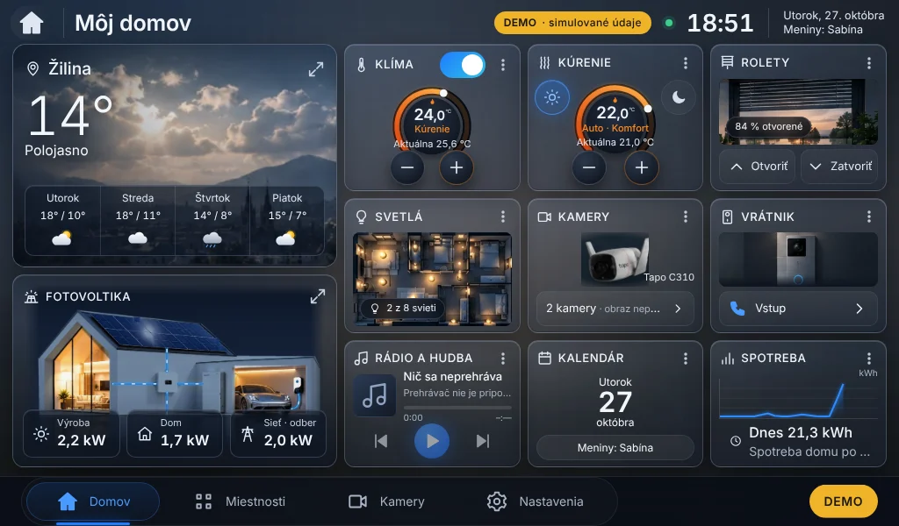
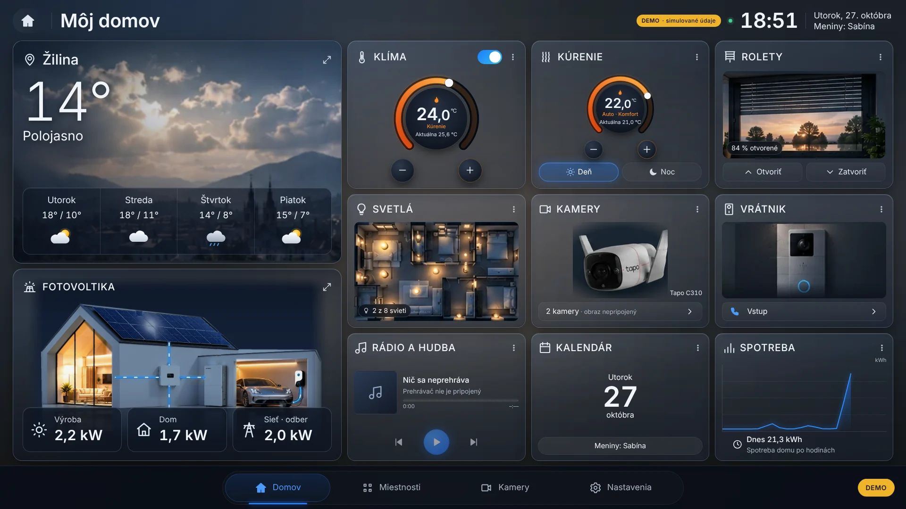
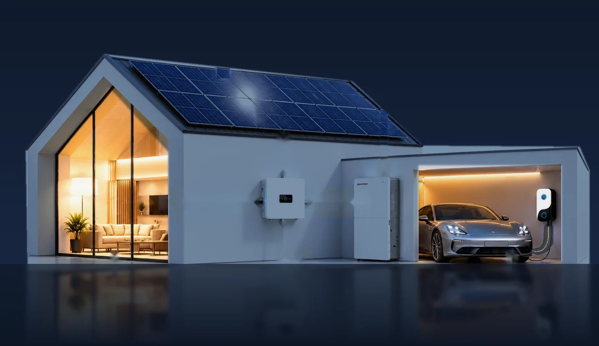

# SolarGroup Home v0.3.0 – etapa E1: správa

Stav: **hotové na kontrolu**. Etapa E2 ani ďalšie etapy sa nezačali.
Na Raspberry Pi sa nič nemenilo a nič sa nenasadilo.

## 1. Čo E1 obsahuje

| Oblasť | Zmena |
|---|---|
| Hlavná obrazovka | schválené rozloženie a tmavý glassmorphism bez zmeny kompozície (pevná mriežka podľa „Môj domov“, 11 modulov bez posúvania od 1024 × 600 po 2560 × 1440) |
| Solárny dom | **schválený dom** (biely dom so sedlovou strechou, veľká presklená obývačka, menič, batéria, garáž, **sivé Porsche Taycan** a wallbox, **bez stromov**) – vyčistený od zapečených textov, hodnôt a odkazových čiar, večerne ladený (tmavomodrá obloha, teplé svetlo v interiéri a garáži, lesklá podlaha s odrazom) |
| Toky energie | samostatná SVG vrstva nad obrázkom: panely → menič, menič → dom, menič ↔ batéria, sieť ↔ menič, wallbox → auto. Modrá čiara a pohybujúce sa impulzy **iba pri skutočnom výkone** (≥ 0,05 kW), smer podľa znamienka (nabíjanie/vybíjanie, odber/dodávka), rýchlosť podľa veľkosti výkonu. Bez údajov sú vidieť iba tmavé vedenia. |
| Stránka Fotovoltika | rovnaký dom a toky s popismi hodnôt (obsah stránky rozšíri E2) |
| Ostrosť | dom v dvoch veľkostiach (826 px pre 7", 1651 px pre Full HD), prehliadač si vyberie; obrázok kamery sa nezväčšuje nad svoje rozlíšenie; žiadny `zoom` ani transformácie textu; sklo bez `backdrop-filter` |
| Výkon Pi 4 | prepínač **Bez animácií**; animácie iba pri zmene alebo pri aktívnom toku; žiadne rozmazávanie v reálnom čase |
| Diagnostika displeja | Nastavenia → Tento displej: okno, obrazovka, mierka (DPR), fyzické pixely, GPU (rozpozná softvérové vykresľovanie), pamäť stránky, jadrá CPU, verzia prehliadača, meranie FPS; upozornenia pri neceločíselnej mierke, bez GPU a pri okne menšom ako obrazovka |
| Verzia | 0.3.0 (backend `/api/system`, frontend) |
| Reprodukovateľnosť grafiky | `tools/design/solar_house_clean.py` a `solar_house_night.py` vytvoria podklad zo zdroja `docs/design/schvaleny-solarny-dom-zdroj.png` (overené: výsledok je bajt po bajte rovnaký) |

Ďalšie snímky: [Fotovoltika 1024 × 600](e1/fotovoltika-1024x600.webp),
[Diagnostika displeja](e1/displej-diagnostika-1024x600.webp).

## 2. Výsledky automatických testov

| Test | Výsledok |
|---|---|
| Backend: `ruff check`, `ruff format --check` | ✅ bez chýb |
| Backend: `pytest` | ✅ 53 / 53 |
| Frontend: `tsc` (typy) | ✅ |
| Frontend: `vitest` | ✅ 43 / 43 (nové: toky energie – smer, nečinnosť, rýchlosť; prepínač Bez animácií) |
| Frontend: `vite build` (produkčné zostavenie) | ✅ |
| `npm audit --omit=dev` | ✅ 0 zraniteľností |
| Skripty: `shellcheck` | ✅ bez varovaní |
| E2E (Playwright, Chromium, emulácia) | ✅ **61 / 61**: bez posúvania a 11 modulov pri 1024 × 600, 1280 × 800, 1366 × 768, 1920 × 1080, 2560 × 1440; mobil bez vodorovného posúvania; dotykové ciele ≥ 40 px; ťuknutie na kartu otvorí detail; všetky obrázky načítané; **žiadny obrázok sa nezväčšuje** (ostrosť); animované toky na karte Fotovoltika; klávesnica a prihlásenie dotykom; USB klávesnica; 3-minútový beh bez rastu pamäte (9,5 → 9,5 MB) |
| Simulácia inštalácie (náhradné `systemctl`/`sudo`, skutočný backend) | ✅ 0.1.0 → 0.2.0 → **0.3.0** (dry-run, záloha, overenie, účet a údaje zachované) a **návrat 0.3.0 → 0.2.0** (kód, údaje, autostart, skripty kiosku); `solar-dashboard-v1.4` nezmenený (odtlačok) |

### Informatívne (nie chyba testu)

Dočasná fotografia počasia sa zobrazuje v pomere 1,08× na 7" (ostrá), ale 0,57× na Full HD
(zväčšená, mierne rozmazaná). Je to výrez z referencie – **čaká na podklad G4** (kapitola 3 plánu).
Na cieľovom 7" displeji je ostrá.

## 3. Čo NEBOLO overené (vyžaduje Raspberry Pi)

| Test | Postup na Pi |
|---|---|
| Ostrosť: mierka 1, GPU „V3D“ | Nastavenia → Tento displej → Zistiť parametre displeja |
| Plynulosť animácií tokov (cieľ ≥ 30 FPS) | Nastavenia → Zmerať plynulosť; porovnať so zapnutým „Bez animácií“ |
| Kontrast kariet na displeji Waveshare (deň/noc) | vizuálne |
| RAM Chromia počas 24 h | `grep súhrn ~/.local/state/solargroup-home/watch.log` |
| Inštalátor 0.2.0 → 0.3.0 a rollback na skutočnom Debiane 13 | `./install-pi-update.sh --dry-run`, potom bez `--dry-run` |
| Reštart Pi, autostart kiosku, dotyk | podľa [RASPBERRY_PI_KIOSK.md](RASPBERRY_PI_KIOSK.md) kap. 7 |

Žiadny z týchto bodov nie je označený ako úspešný – simulácia v prehliadači nenahrádza test na hardvéri.

## 4. Návrat na v0.2.0

- Inštalátor 0.3.0 pred zmenou vytvorí zálohu celej inštalácie 0.2.0 (kód, údaje, `.env`, autostart,
  skripty kiosku) a pri neúspešnom štarte sa sám vráti.
- Ručný návrat: `~/solargroup-home-backups/<čas>-v0.2.0/sgh-rollback.sh`.
- Pôvodný balík **solargroup-home-pi-0.2.0** je priložený v ZIP-e (`navrat-v0.2.0/`) – dá sa nainštalovať
  rovnakým inštalátorom aj bez zálohy. Zdrojový kód v0.2.0 = commit `714370a` v GitHub vetve.
- SolarGroup PV Dashboard v1.4 inštalátor ani rollback nemenia (overujú to odtlačkom).

## 5. Grafické podklady – stav

| # | Podklad | Stav |
|---|---|---|
| G1 | Solárny dom večer | ✅ zo schváleného obrázka (1651 × 953). Pre 4K displeje by bol vhodný zdroj ≥ 2560 px – nezväčšoval som ho umelo |
| G2 | Vrstvy tokov | ✅ SVG trasy v kóde (`HouseScene.tsx`) |
| G4 | Počasie Žilina (6 variantov) | ⏳ chýba – dočasný výrez 399 px |
| G5 | Pozadie aplikácie | ✅ (vopred rozmazané, rozlíšenie nehrá rolu) |
| G3, G6, G7 | Taycan pri wallboxe, čistý pôdorys, kamera/vrátnik/roleta | patria do etáp E2/E5 |

## 6. Odporúčaný postup kontroly

1. Stiahnuť ZIP z GitHubu (odkaz v PR #1) a pozrieť snímky v `docs/e1/`.
2. Po schválení: na Pi `./install-pi-update.sh --dry-run`, potom inštalácia, test podľa kapitoly 3.
3. Výsledky (diagnostika displeja, FPS, prípadne `sgh-diag.sh`) poslať na vyhodnotenie.
