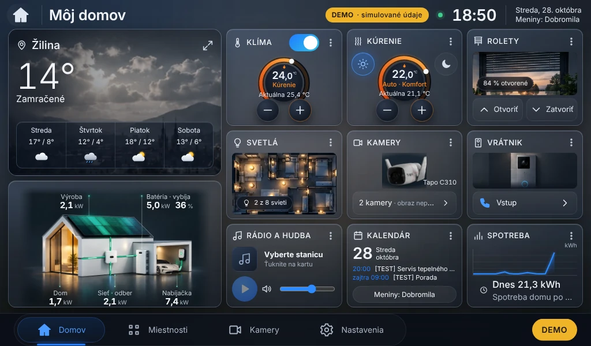
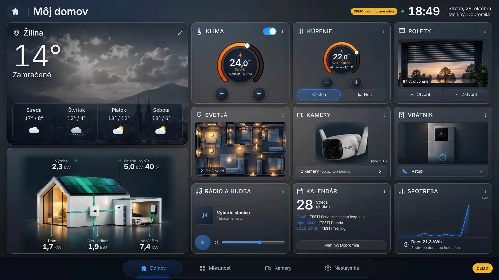
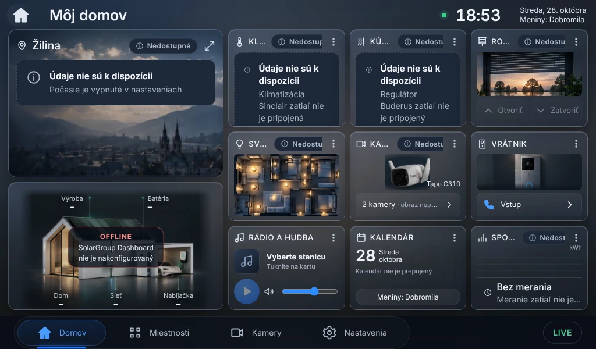
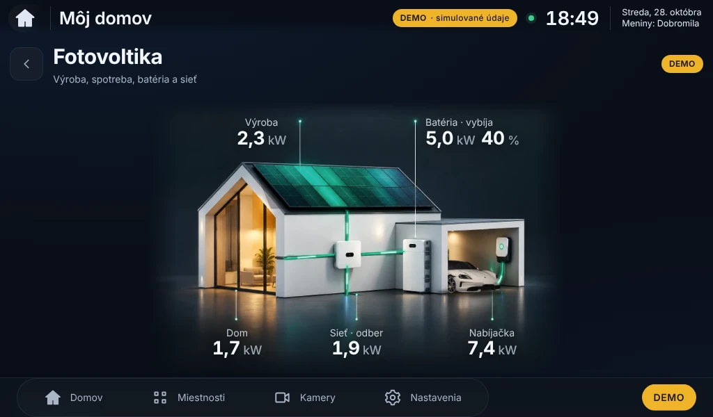

# SolarGroup Home v0.4.0 – etapa E2: správa

Stav: **hotové na schválenie (finálny náhľad)**.
Na Raspberry Pi sa nič nemenilo a nič sa nenasadilo. Projekt SolarGroup PV Dashboard v1.4 nebol dotknutý.

E2 obsahuje tri časti: **Fotovoltika** so schváleným domom (biele Porsche Taycan), **internetové rádio**
a **Google Kalendár**. Ostatné moduly a rozloženie hlavnej obrazovky z E1 ostali bez zmeny.

## 1. Prehľad zmien

### Fotovoltika

| Oblasť | Zmena |
|---|---|
| Obrázok | schválený dom s **bielym Porsche Taycan** (`docs/design/schvaleny-dom-e2-porsche.png`). Zapečené čísla a popisy sú **odstránené** (inpaint a dokreslenie podkladu, nie rozmazané záplaty). Dve veľkosti WebP (768 a 1536 px); prehliadač si vyberie podľa displeja. |
| Hodnoty | 5 hodnôt vykreslených v Reacte okolo domu, na miestach podľa obrázka: **Výroba, Batéria (+ SOC, nabíja/vybíja), Dom, Sieť (odber/dodávka), Nabíjačka**. Veľkosť písma sa prispôsobuje šírke karty (7" aj 13,3"). |
| Toky energie | tyrkysovozelené jemné svetelné pásy (bez pohybujúcich sa bodiek) po vedeniach obrázka: panely → menič, menič → dom, menič ↔ batéria, sieť ↔ menič, wallbox → auto. Smer podľa znamienka skutočného výkonu, rýchlosť podľa veľkosti; **pri nulovom výkone je tok vypnutý**. |
| Panely | samostatná vrstva žiary panelov, jas podľa aktuálnej výroby (0 pri nulovej výrobe). |
| OFFLINE | pri chýbajúcich alebo zastaraných údajoch sa namiesto čísel zobrazí „–“, toky aj žiara sú vypnuté a v strede je hlásenie **OFFLINE** / **Údaje nie sú aktuálne** s časom posledných údajov. Žiadne vymyslené hodnoty. |
| Karta | bez nadpisu „Fotovoltika“, celá karta je klikateľná a otvorí **detail na celú obrazovku** (`/fotovoltika`) s tou istou scénou a štatistikami. |
| Výkon Pi 4 | animuje sa iba `stroke-dashoffset` a `opacity` (bez rozmazávania v reálnom čase); prepínač **Bez animácií** všetko zastaví. |

### Internetové rádio

| Oblasť | Zmena |
|---|---|
| Prehrávač | skutočné streamy cez `<audio>`: Prehrať / Pozastaviť / Stop, predchádzajúca/ďalšia stanica, hlasitosť, hviezdička. Zobrazuje stanicu, stav (Pripája sa / Hrá / Pozastavené / chyba pripojenia). |
| Na pozadí | jeden prehrávač pre celú aplikáciu – **hrá ďalej pri prepínaní obrazoviek**. |
| Bez autoštartu | po reštarte Pi sa obnoví posledná stanica, hlasitosť a obľúbené, ale **prehrávanie sa spustí až ťuknutím na Prehrať** (zároveň rešpektuje pravidlá autoplay v Chromiu). |
| Slovenské predvoľby | Rádio Expres, Fun rádio, Rádio Slovensko, Europa 2, Rádio Vlna, Rádio Melody, Rádio_FM – kandidátske adresy, označené **Neoverená**, kým ich neoverí skript na Pi/PC. |
| Katalóg | Radio Browser API: krajiny SK, CZ, AT, DE, HU, PL, IT, FR, GB, US, ES, HR; vyhľadávanie podľa názvu; žánre Pop, Rock, Dance, 80s, 90s, Oldies, Jazz, Chillout, Classical, News. Logá staníc cez backend (cache, max 256 kB, bez SVG). |
| Vlastná URL | pridanie vlastného streamu (aj .m3u/.pls); po uložení sa hneď overí. |
| Overenie | backend skontroluje dostupnosť a formát (MP3/AAC/OGG/OPUS/FLAC; HLS = nepodporovaný). Nefunkčné stanice sú označené **Nedostupná** alebo **Nepodporovaný formát** a nedajú sa spustiť. Prehliadač navyše overí, či formát dokáže prehrať (`canPlayType`). |
| Výstup zvuku | výber zvukového výstupu (ak ho prehliadač podporuje) – pripravené na externý reproduktor/zosilňovač (HDMI, USB, 3,5 mm). |
| Skript | `deploy/pi/sgh-radio-check.sh` – overí stanice priamo na Pi/PC (`--favorites`, `--fix` nahradí nefunkčnú predvoľbu funkčnou z katalógu, `--url`, `--search`). |

### Google Kalendár

| Oblasť | Zmena |
|---|---|
| Google OAuth 2.0 | oficiálne Google Calendar API, rozsah **iba na čítanie** (`calendar.readonly`), PKCE, overenie `state`. **Heslo Google sa nikdy nezadáva do aplikácie.** |
| Súkromná iCal adresa | alternatíva bez Cloud Console; podporuje aj `webcal://`, Outlook, iCloud, Nextcloud; opakujúce sa udalosti. |
| Bezpečnosť | obnovovací token a iCal adresa sú v databáze **šifrované** (Fernet), kľúč `data/secret.key` s právami 0600; tajomstvá nikdy neodchádzajú do prehliadača. Client ID/secret iba v `backend/.env`, nie v kóde. |
| Synchronizácia | na pozadí každých 10 minút, **neblokuje dashboard**; tlačidlo Synchronizovať teraz; čas poslednej synchronizácie. |
| Offline | ostanú posledné uložené udalosti s označením **Nesynchronizované – posledné údaje …**. |
| Karta | dátum, meniny, štátny sviatok, najbližšie udalosti; klik otvorí detail. |
| Detail | zobrazenia **Dnes a najbližšie / Týždeň / Mesiac**, slovenské názvy dní a mesiacov, meniny, **štátne sviatky SR** vrátane Veľkého piatku a Veľkonočného pondelka, časové pásmo Europe/Bratislava, výber kalendárov, správa zdrojov. |
| Návod | [docs/GOOGLE_KALENDAR.md](GOOGLE_KALENDAR.md) – nastavenie Google Cloud Console krok za krokom. |

### Ostatné
- Verzia **0.4.0** (backend `/api/system`, frontend).
- Databáza: schéma v3 (nové tabuľky rádia a kalendára), automatická migrácia z v2; staršia verzia 0.3.0 funguje aj nad databázou v3 (overené).
- Inštalátor kontroluje nové Python balíky (`cryptography`, `icalendar`, `recurring-ical-events`) a pri zmene spustí `pip install` (na Pi je pri aktualizácii potrebný internet).

## 2. Náhľady

Hlavná obrazovka 7" (1024 × 600), DEMO:

Hlavná obrazovka 1920 × 1080 (orientačne pre 13,3"):

Bez údajov (LIVE bez pripojeného SolarGroup Dashboardu) – OFFLINE namiesto čísel:

Detail Fotovoltika:

Ďalšie snímky:
[Fotovoltika 1920 × 1080](e2/fotovoltika-1920x1080.webp) ·
[Rádio](e2/radio-1024x600.webp) · [Rádio – katalóg](e2/radio-katalog-1024x600.webp) · [Rádio 1920 × 1080](e2/radio-1920x1080.webp) ·
[Kalendár](e2/kalendar-1024x600.webp) · [Kalendár – mesiac](e2/kalendar-mesiac-1024x600.webp) ·
[Kalendár – zdroje](e2/kalendar-zdroje-1024x600.webp) · [Kalendár – týždeň 1920 × 1080](e2/kalendar-tyzden-1920x1080.webp) ·
[Kalendár – mesiac 1920 × 1080](e2/kalendar-mesiac-1920x1080.webp)

Poznámka k náhľadom: udalosti označené **[TEST]** boli vložené iba do vývojovej databázy pre ukážku rozloženia
(nie sú v kóde ani v balíku). Rádiá sú v náhľade „Neoverené“, lebo prostredie vývoja nemá prístup na streamy.
Katalóg Radio Browser v náhľade nie je dostupný z rovnakého dôvodu.

## 3. Výsledky testov

| Test | Výsledok |
|---|---|
| Backend: `ruff check`, `ruff format --check` | ✅ bez chýb |
| Backend: `pytest` | ✅ **78 / 78** (nové: rádio 18 – predvoľby, obľúbené, stav, blokovanie lokálnych adries, katalóg a cache, offline, logá, overenie streamov, migrácia v2→v3; kalendár 7 – iCal s opakovaním a celodennými udalosťami, šifrovanie a práva kľúča, neplatná adresa, offline s poslednými udalosťami, celý Google OAuth tok so simulovaným Google API, prihlásenie iba na zariadení, povinné prihlásenie) |
| Frontend: `tsc` | ✅ |
| Frontend: `vitest` | ✅ **54 / 54** (nové: scéna PV – toky, smer, nečinnosť, OFFLINE; rádio – bez autoštartu, hrá pri prepnutí obrazovky, uloženie hlasitosti, HLS, obľúbené; kalendár – Veľká noc a sviatky, celodenné udalosti, karta, offline, detail a pridanie iCal) |
| Frontend: `vite build` | ✅ |
| `npm audit` | ✅ 0 zraniteľností |
| `shellcheck` | ✅ bez varovaní |
| E2E (Playwright, Chromium, emulácia) | ✅ **85 / 85**: bez posúvania a všetkých 11 modulov pri 1024 × 600, 1280 × 800, 1366 × 768, 1920 × 1080, 2560 × 1440; 5 hodnôt PV v rámci karty; animované toky (DEMO); **rádio sa po štarte samo nespustí**; klik na kartu PV otvorí detail; rádio a kalendár bez vodorovného posúvania; obrázky sa nezväčšujú; dotykové prvky ≥ 40 px; klávesnica |
| Simulácia inštalácie (náhradné `systemctl`/`sudo`, skutočný backend) | ✅ 0.3.0 → **0.4.0** (dry-run, záloha, pip, overenie verzie, migrácia DB v2→v3, účet zachovaný, 7 predvolieb rádií); **návrat 0.4.0 → 0.3.0** s obnovou údajov aj so zachovaním nových údajov (`--keep-data`); `solar-dashboard-v1.4` nezmenený (odtlačok) |

## 4. Neoverené (vyžaduje fyzické Raspberry Pi alebo internet)

Tieto body **nie sú označené ako úspešné**:

- **Dostupnosť streamov** slovenských rádií a katalógu Radio Browser – vývojové prostredie má prístup na tieto adresy zablokovaný. Overenie: `deploy/pi/sgh-radio-check.sh --fix` na Pi.
- **Skutočné prehrávanie zvuku** v Chromiu na Pi 4 (HDMI/3,5 mm/USB), výber výstupu a vyťaženie CPU počas prehrávania.
- **Prihlásenie Google** so skutočným účtom a Client ID (testované len so simulovaným Google API) a stiahnutie skutočnej iCal adresy.
- Plynulosť animácií tokov a pamäť na Pi 4 s 1 GB RAM (meranie FPS je v Nastavenia → Tento displej).
- Inštalácia `pip` balíkov na Pi (potrebný internet; `cryptography` má hotové balíky pre aarch64).
- Displej 13,3" (náhľad 1920 × 1080 je iba orientačný).

## 5. Nedokončené / obmedzenia

- **HLS streamy (.m3u8)** nie sú podporované (Chromium ich bez ďalšej knižnice neprehrá) – sú zreteľne označené.
- Prihlásenie Google je možné **iba priamo na displeji zariadenia** (Google povoľuje návrat iba na 127.0.0.1); zo vzdialeného prehliadača by bola potrebná HTTPS doména.
- Aplikácia v Google Cloud Console musí byť v stave **In production**, inak Google token po 7 dňoch zruší.
- **Sviatky**: zobrazujú sa názvy podľa zákona č. 241/1993 Z. z.; či je deň voľný, sa môže meniť novelami – pri zmene zákona treba zoznam overiť (`frontend/src/utils/holidays.ts`).
- **Licencia fotografie Porsche** použitej v grafike – pre súkromné použitie v poriadku; pri komerčnom použití treba overiť práva k podkladu.
- Zápis do kalendára (vytváranie udalostí) nie je súčasťou E2 – prístup je zámerne iba na čítanie.

## 6. Zmenené súbory (od E1)

Backend: `app/radio.py`, `app/routers/radio.py`, `app/calendar_sync.py`, `app/routers/calendar.py`,
`app/secrets_store.py` (nové); `app/main.py`, `app/config.py`, `app/db.py`, `app/cli.py`, `app/__init__.py`,
`requirements.txt`, `.env.example`; testy `tests/test_radio.py`, `tests/test_calendar.py`.

Frontend: `pages/Radio.tsx`, `pages/Calendar.tsx`, `radio/RadioProvider.tsx`, `utils/holidays.ts`,
`assets/design/pv-house-base-768.webp`, `pv-house-base-1536.webp`, `pv-house-glow.webp` (nové);
`components/HouseScene.tsx` (scéna PV), `components/Icon.tsx`, `pages/Home.tsx`, `pages/HomeBoard.tsx`,
`pages/Solar.tsx`, `pages/Misc.tsx`, `App.tsx`, `main.tsx`, `api/client.ts`, `api/types.ts`, `styles/global.css`,
`e2e/kiosk-check.mjs`, `package.json`; testy `houseScene`, `radio`, `calendar`, `app`.
Odstránené: `components/SolarScene.tsx`, `solar-house-826/1651.webp` (podklad E1).

Nasadenie: `deploy/pi/sgh-radio-check.sh` (nový), `deploy/pi/install-pi-update.sh` (kontrola nových balíkov).

Grafika: `docs/design/schvaleny-dom-e2-porsche.png`, `tools/design/porsche/*.py`, `tools/design/e2/house_layers.py`.

Dokumentácia: `docs/E2_ANALYZA_A_PLAN.md`, `docs/GOOGLE_KALENDAR.md`, `docs/E2_SPRAVA.md`, `docs/e2/*.webp`.

## 7. Bezpečný postup nasadenia (až po schválení)

1. Na PC: `scripts/build-pi-package.sh` → `build/solargroup-home-pi-0.4.0.tar.gz` (+ `.sha256`).
2. Skopírovať na Pi (`scp`), overiť `sha256sum -c`, rozbaliť.
3. `./install-pi-update.sh --dry-run` – nič nemení, ukáže plán (zastavenie, záloha, pip, overenie).
4. `./install-pi-update.sh` – záloha do `~/solargroup-home-backups/<čas>-v0.3.0`, aktualizácia, `pip install`
   (potrebný internet), spustenie a overenie verzie 0.4.0; pri chybe **automatický návrat** na 0.3.0.
   `backend/.env`, `backend/data` a `solar-dashboard-v1.4` sa nemenia.
5. Overenie rádií: `~/solargroup-home-kiosk/sgh-radio-check.sh --fix` (alebo z adresára aplikácie `deploy/pi/`).
6. Kalendár: podľa [GOOGLE_KALENDAR.md](GOOGLE_KALENDAR.md) doplniť Client ID do `backend/.env`,
   reštartovať službu a prihlásiť sa na displeji; alebo pridať súkromnú iCal adresu.
7. Návrat: `~/solargroup-home-backups/<záloha>/sgh-rollback.sh <záloha>` (voliteľne `--keep-data`).
   Zálohujte aj `backend/data/secret.key` – bez neho treba kalendár pripojiť znova.
