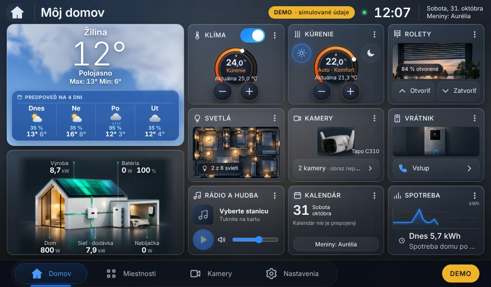
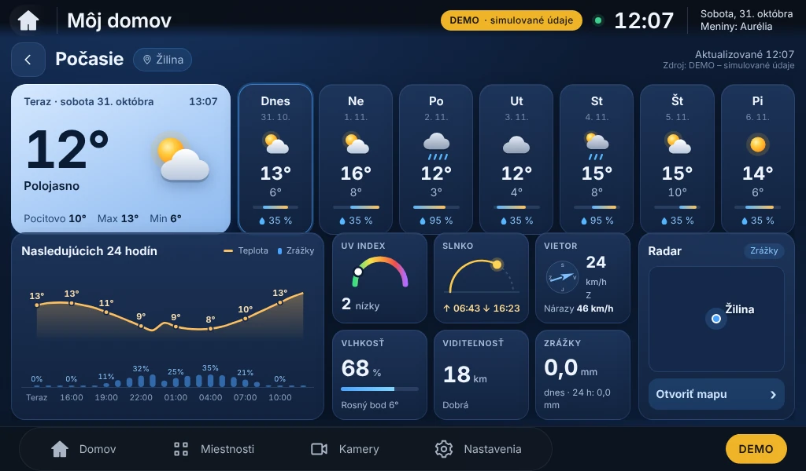
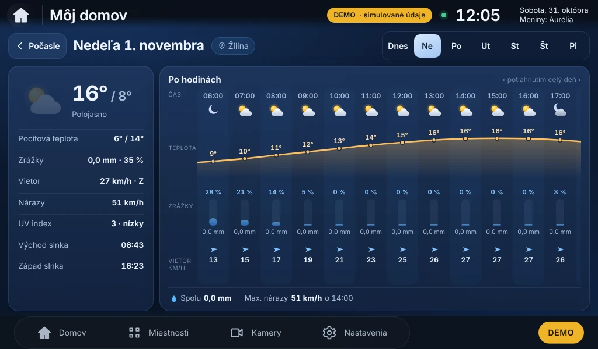

# SolarGroup Home v0.5.0 – etapa E4: Luxusné interaktívne počasie

Stav: **implementované a otestované v projektovej vetve, čaká na schválenie nasadenia.**
Na Raspberry Pi sa nič neinštalovalo. SolarGroup PV Dashboard v1.4 nebol dotknutý.
Optimalizácia výkonu 0.4.1 (toky energie) **nie je súčasťou E4** – je samostatná (pozri bod 6).

## 1. Čo E4 obsahuje (podľa schválených návrhov `docs/navrh-e4`)

| Časť | Implementácia |
|---|---|
| Karta na úvodnej obrazovke | svetlá modrá obloha s oblakmi podľa aktuálneho počasia (6 variantov: jasno, polojasno, zamračené, dážď, sneh, hmla), veľká biela teplota, Žilina, opis, Max/Min, výraznejší modrý panel s predpoveďou na 4 dni; **jemne zvýšený kontrast** bieleho textu (tmavší tieň a stmavenie za textom). Bez ikony dvoch šípok – ťuknutie kdekoľvek otvorí stránku počasia. Veľkosť a poloha v mriežke nezmenené. |
| Hlavná stránka `/pocasie` | karta „Teraz“ (teplota, pocitová, opis, max/min), 7 dotykových dní s teplotným rozsahom a zrážkami, graf 24 h (teplota + pravdepodobnosť zrážok), UV index s ukazovateľom, východ/západ slnka s oblúkom, vietor (kompas, nárazy), vlhkosť (rosný bod), viditeľnosť, zrážky, karta **Radar**. Zdroj a čas aktualizácie. |
| Detail dňa `/pocasie/den/<dátum>` | súhrn dňa, 24 hodinových stĺpcov (ikona, krivka teploty, pravdepodobnosť a množstvo zrážok, smer a rýchlosť vetra), posúvanie prstom, prepínač dní, tlačidlo **‹ Počasie**. |
| Radar `/pocasie/radar` | otvorí sa **iba po ťuknutí** na kartu Radar; mapa Žiliny a okolia (posun prstom, priblíženie +/− aj dvoma prstami, návrat na Žilinu), vrstva zrážok, animácia posledných ~2 h (Prehrať/Zastaviť, posúvač času), legenda intenzity, uvedenie zdrojov, tlačidlo **‹ Počasie**. |
| Bez internetu | posledná predpoveď sa ukladá na disk (`data/weather-cache.json`) – po výpadku aj po reštarte sa zobrazí s označením **Nesynchronizované · posledná predpoveď HH:MM**; bez uložených údajov **OFFLINE**. Mapové dlaždice sa ukladajú 30 dní (`data/map-tiles`). Nič sa nevymýšľa. |
| DEMO | simulované údaje na 7 dní a 168 hodín, zreteľne označené „DEMO – simulované údaje“. |

## 2. Dátové služby a podmienky (overené 31. 10. 2026)

Oficiálne stránky služieb sú z vývojového prostredia zablokované, podmienky som overil vyhľadávaním
(zdroje nižšie). Pred nasadením odporúčam ich krátku kontrolu priamo na stránkach služieb.

| Služba | Použitie | Podmienky | Splnenie |
|---|---|---|---|
| **Open-Meteo** (predpoveď) | aktuálny stav, 7 dní, 168 hodín | bezplatné API iba na **nekomerčné** použitie, do 10 000 volaní/deň; údaje **CC BY 4.0** (uviesť zdroj) | súkromný domáci projekt ✔; ~144 volaní/deň (vyrovnávacia pamäť 10 min) ✔; „Zdroj: Open-Meteo (CC BY 4.0)“ na stránke ✔ |
| **RainViewer** (radar) | snímky zrážok za posledné ~2 h | bezplatné API pre **osobné** a vzdelávacie použitie, povinné uvedenie zdroja; bez API kľúča; bez záruky dostupnosti; podľa zdrojov tretích strán bezplatná úroveň od 2026 obmedzená (priblíženie do úrovne 7, jedna farebná schéma, bez predpovede zrážok) | osobné použitie ✔; „Radar: RainViewer“ na mape ✔; snímky sa sťahujú iba pri otvorenom radare, dlaždice sa ukladajú do pamäte ✔; priblíženie zrážok najviac 7 (pri väčšom sa dlaždica zväčší) ✔ |
| **OpenStreetMap** (mapový podklad) | dlaždice okolia Žiliny | malé použitie povolené; vlastný User-Agent; ukladanie dlaždíc; uviesť „© OpenStreetMap prispievatelia“ | User-Agent „SolarGroupHome/0.5.0 (private home dashboard; +odkaz na projekt)“ ✔; disková pamäť 30 dní, iba oblasť Slovenska (bez neobmedzeného rastu) ✔; uvedenie zdroja ✔ |
| **Leaflet 1.9.4** (knižnica mapy) | posun, priblíženie dotykom | licencia BSD-2 | ✔; načíta sa iba so stránkou radaru (samostatný balík 45 kB gzip) |

Bezpečnosť: všetky mapové a radarové dlaždice idú **cez backend** – prehliadač kiosku naďalej načítava
obrázky iba z vlastného servera (CSP sa nemenila). Backend prísne overuje súradnice, čísla snímok,
cesty z RainViewer (iba `/v2/radar/…`) aj typ odpovede (iba PNG do 1 MB); všetko vyžaduje prihlásenie.

## 3. Výkon (Raspberry Pi 4, 1 GB RAM)

Meranie prekresľovania v Chromiu (10 s nečinnosti, 1024 × 600):

| Obrazovka | Prekreslenia | Rasterizácia | Hlavné vlákno |
|---|---|---|---|
| Počasie – hlavná stránka | **0** | 0 | 0,2 % |
| Počasie – detail dňa | **0** | 0 | 0,2 % |
| Radar (nečinný, bez prehrávania) | **0** | 0 | 0,1 % |

- Grafy sú statické SVG; jediná animácia je jednorazový nástup hlavnej ikony (0,6 s).
- Radar: animácia beží iba po ťuknutí na Prehrať, najviac 3 kolá a potom sa zastaví; snímky sa obnovujú
  každých 5 minút iba pri otvorenom radare. Pri odchode zo stránky sa zrušia časovače, odstránia vrstvy a mapa
  sa uvoľní z pamäte (overené testom).
- Na pozadí karty sú statické obrázky (5–14 kB), bez rozmazávania pozadia (backdrop-filter).
- Nové Python balíky: **žiadne** (inštalácia nepotrebuje `pip`).

## 4. Výsledky testov

| Test | Výsledok |
|---|---|
| Backend: `ruff check`, `ruff format --check` | ✅ |
| Backend: `pytest` | ✅ **85 / 85** (nové 7: parsovanie Open-Meteo vrátane chýbajúcich hodnôt, parametre požiadavky, uloženie a offline po reštarte, DEMO 7 dní/168 h, radar – snímky, overenie ciest, dlaždice, vyrovnávacia pamäť, limit priblíženia, mapa – oblasť, disková pamäť, chybný obsah, offline, povinné prihlásenie) |
| Frontend: `tsc`, `vite build` | ✅ |
| Frontend: `vitest` | ✅ **61 / 61** (nové 7: WMO kódy, smer vetra, UV, rosný bod; karta – obloha, 4 dni, odkaz, bez šípok, offline; hlavná stránka – 7 dní, dlaždice, radar iba ako odkaz; offline bez vymyslených hodnôt; detail dňa – 24 h, prepínač; radar – prehrávanie, zastavenie a uvoľnenie pri odchode) |
| `npm audit` | ✅ 0 zraniteľností |
| `shellcheck` | ✅ |
| E2E (Playwright, Chromium) | ✅ **120 / 120** – 5 rozlíšení na šírku + mobil; karta Počasie v mriežke; ťuknutie na kartu → stránka počasia **bez posúvania**; 7 dní, 6 dlaždíc, graf; radar sa nenačíta pred otvorením; deň → 24 h bez posúvania stránky; radar sa otvorí po ťuknutí a **po odchode sa uvoľní**; ostatné moduly ako predtým |
| Simulácia inštalácie | ✅ 0.3.0 → 0.4.0 → **0.5.0** (bez pip, verzia overená, PV Dashboard v1.4 nezmenený) a **návrat 0.5.0 → 0.4.0** |

## 5. Neoverené (vyžaduje Raspberry Pi s internetom)

- **Skutočné údaje Open-Meteo** (všetky nové premenné vrátane viditeľnosti a UV) – testované so simulovanou odpoveďou.
- **Skutočné snímky RainViewer a mapové dlaždice OpenStreetMap** – z vývojového prostredia nedostupné;
  náhľad radaru je preto v stave „Radar je nedostupný (bez internetu?)“. Treba overiť aj farebnú schému
  (legenda zodpovedá schéme č. 2; nastaviteľná cez `SGH_RADAR_COLOR`) a skutočný limit priblíženia (`SGH_RADAR_MAX_ZOOM`).
- Plynulosť posúvania a priblíženia mapy dotykom na Pi 4 a pamäť počas animácie radaru.
- Displej 13,3" (náhľad 1920 × 1080 je orientačný).

## 6. Dôležité pred nasadením

E4 je postavená na verzii 0.4.0. **Neobsahuje optimalizáciu 0.4.1** – animované toky energie na karte Fotovoltika
by na Pi naďalej spôsobovali vysoké zaťaženie GPU (zistené v diagnostike). Odporúčam pred nasadením E4
pripraviť a schváliť aj 0.4.1, alebo nasadiť obe naraz.

## 7. Náhľady

Ďalšie: [Počasie 1920 × 1080](e4/pocasie-1920x1080.webp) · [Detail dňa 1920 × 1080](e4/pocasie-den-1920x1080.webp) ·
[Radar bez internetu](e4/pocasie-radar-offline-1024x600.webp) · [Mobil](e4/domov-mobil-390x844.webp)

Hodnoty v náhľadoch sú **DEMO (simulované)**.

## 8. Zmenené súbory

Backend: `app/adapters/openmeteo.py` (nový), `app/weather_maps.py` (nový), `app/routers/weather_maps.py` (nový),
`app/adapters/live.py`, `app/adapters/demo.py`, `app/models.py`, `app/config.py`, `app/main.py`, `app/__init__.py`;
test `tests/test_weather.py` (nový).

Frontend: `pages/Weather.tsx` (prepísaný), `pages/WeatherRadar.tsx` (nový), `components/WxIcon.tsx` (nový),
`styles/weather.css` (nový), `assets/weather/sky-*.webp` (nové), `pages/HomeBoard.tsx`, `pages/Home.tsx`, `App.tsx`,
`api/types.ts`, `package.json` (+ `leaflet` 1.9.4), `e2e/kiosk-check.mjs`; test `test/weather.test.tsx` (nový).
Odstránené: `components/WeatherArt.tsx`, `assets/design/weather-zilina.webp`.

Grafika: `tools/design/e4/sky.py` (generátor oblohy). Dokumentácia: `docs/E4_SPRAVA.md`, `docs/e4/`.

## Zdroje overenia podmienok

- [Open-Meteo – podmienky](https://open-meteo.com/en/terms), [cenník](https://open-meteo.com/en/pricing)
- [RainViewer API](https://www.rainviewer.com/api.html), [Weather Maps API](https://www.rainviewer.com/api/weather-maps-api.html),
  [LibreWXR – obmedzenia 2026](https://github.com/JoshuaKimsey/LibreWXR/wiki)
- [OSM – pravidlá používania dlaždíc](https://operations.osmfoundation.org/policies/tiles/)
