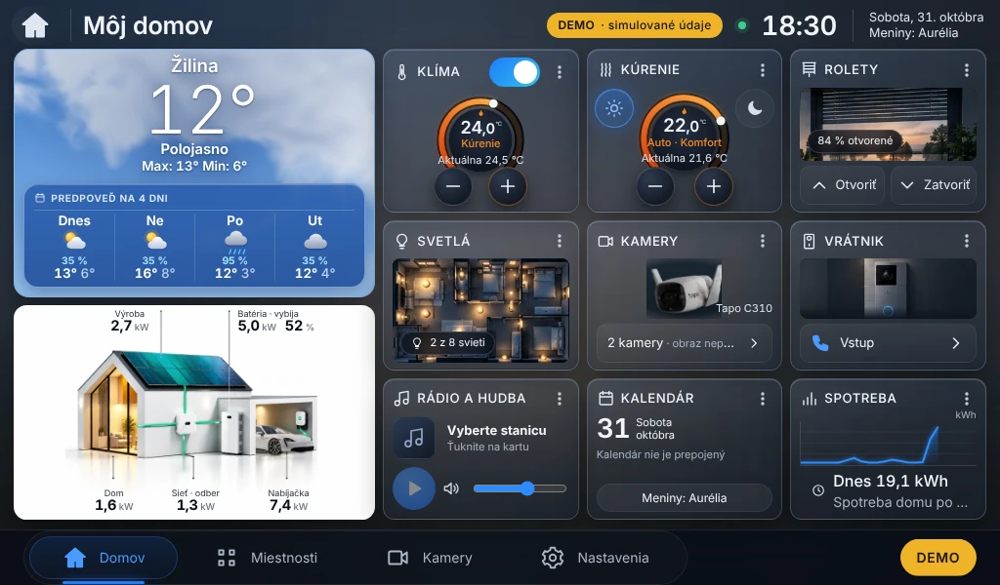
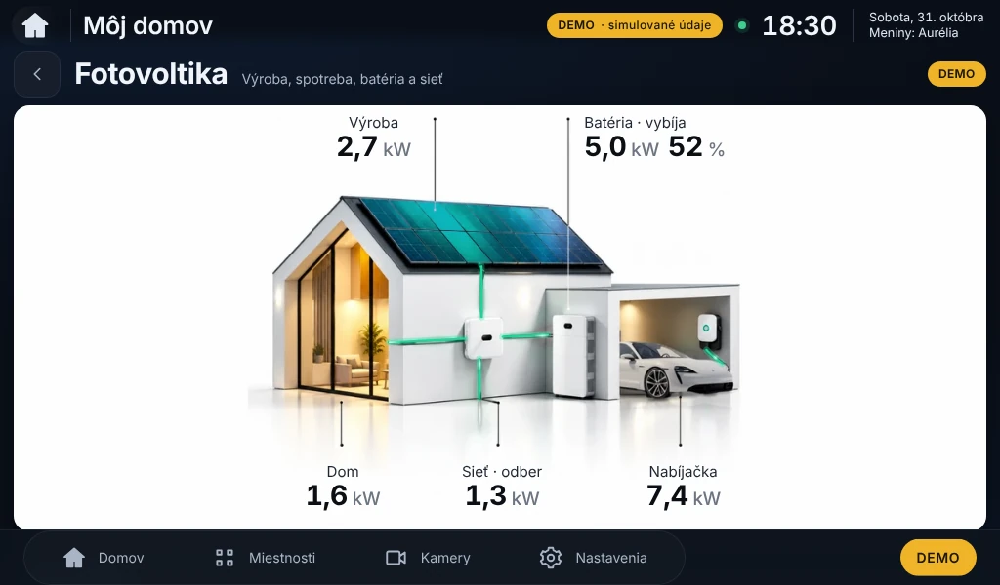

# SolarGroup Home 0.5.2 – Fotovoltika na bielom pozadí s bielym Porsche Taycan

Stav: **pripravené a otestované v projektovej vetve, čaká na potvrdenie inštalácie.**
Na Raspberry Pi sa nič neinštalovalo. SolarGroup PV Dashboard v1.4 sa nemení (skripty ho iba čítajú).

Aktualizácia **0.5.1 → 0.5.2** mení iba grafiku modulu Fotovoltika (schválený návrh, commit `b166bc9`):
schválený dom na čisto bielom pozadí, biele Porsche Taycan vysunuté z garáže, nabíjací kábel so zástrčkou
zasunutou za predný blatník (drobná korekcia napojenia, poloha auta nezmenená), dynamické hodnoty
(nič zapečené v obrázku), optimalizované toky energie z 0.5.1, v detaile o ~8 % väčší dom.
Ostatné moduly vrátane počasia E4 sa nemenia. Python balíky ani databáza sa nemenia.




## 1. Výsledky testov

| Test | Výsledok |
|---|---|
| Backend `ruff`, `pytest` | ✅ 86 / 86 |
| Frontend `tsc`, `vitest`, `vite build` | ✅ 61 / 61 |
| `npm audit` | ✅ 0 zraniteľností |
| `shellcheck` | ✅ |
| E2E (Playwright, Chromium) | ✅ **126 / 126** – 1024 × 600, 1280 × 800, 1366 × 768, 1920 × 1080, 2560 × 1440, mobil; všetky moduly bez posúvania, 5 hodnôt fotovoltiky v rámci karty, toky iba cez `transform` (5 svetiel = 5 tokov), počasie E4 (karta → stránka → deň → radar → uvoľnenie mapy), rádio bez autoštartu, klávesnica |
| Dlhý beh 5 min | ✅ pamäť stránky 9,5 → 9,5 MB |
| Prekresľovanie (10 s nečinnosti, 1024 × 600) | ✅ 0 prekreslení – Môj domov, Fotovoltika, Počasie; hlavné vlákno 0,1–0,8 % |
| Pamäť backendu | ✅ ustálená na 117 MB (4× prechod všetkými obrazovkami) |
| Simulácia na „Pi“ (náhradné systemctl/sudo) | ✅ 0.5.1 → preflight → úplná záloha → dry-run → **0.5.2** (bez pip) → prihlásenie, nastavenia rádia (hlasitosť) a všetky API zachované → **návrat na 0.5.1** s rovnakými nastaveniami; PV Dashboard v1.4 nezmenený |

Neoverené (vyžaduje skutočné Pi): zaťaženie GPU/CPU na Pi 4 a ostrosť na 7" displeji – zmerať v kroku 7.

## 2. Aktualizačný balík

- [solargroup-home-pi-0.5.2.tar.gz](https://github.com/1978jaro-pixel/SolarGroup-Home/raw/claude/epic-einstein-cmyx90/kontrola/solargroup-home-pi-0.5.2.tar.gz)
- [solargroup-home-pi-0.5.2.tar.gz.sha256](https://github.com/1978jaro-pixel/SolarGroup-Home/raw/claude/epic-einstein-cmyx90/kontrola/solargroup-home-pi-0.5.2.tar.gz.sha256)
- SHA-256: `cf58477a80d314c3259777d90af9533f1adc2b2f5a47a1ca3241d5bfef6ec6fa`

## 3. Postup inštalácie (až po potvrdení)

```bash
# PC
scp solargroup-home-pi-0.5.2.tar.gz solargroup-home-pi-0.5.2.tar.gz.sha256 solargroup@192.168.1.192:~/
# Pi (ssh solargroup@192.168.1.192)
cd ~ && sha256sum -c solargroup-home-pi-0.5.2.tar.gz.sha256           # OK
mkdir -p ~/sgh-052 && tar -xzf solargroup-home-pi-0.5.2.tar.gz -C ~/sgh-052
cd ~/sgh-052/solargroup-home-pi-0.5.2 && cat VERSION                   # 0.5.2
top -b -n 3 -d 5 | grep -E "Cpu|chromium|python" | tail -12 > ~/meranie-pred-0.5.2.txt
./sgh-preflight.sh                  # 1. kontrola, nič nemení („Python balíky sa nemenia“, „kontrola prešla“)
./sgh-full-backup.sh                # 2. úplná záloha 0.5.1 (~1 min výpadok)
./install-pi-update.sh --dry-run    # 3. plán, nič nemení
./install-pi-update.sh              # 4. aktualizácia; pri chybe automatický návrat na 0.5.1
~/solargroup-home-kiosk/sgh-kiosk.sh --restart                         # 5. nová verzia na displeji
sleep 60; top -b -n 3 -d 5 | grep -E "Cpu|chromium|python" | tail -12 > ~/meranie-po-0.5.2.txt   # 6.
```

7. Kontrola na displeji: biele pozadie karty Fotovoltika, dom s bielym Porsche, 5 hodnôt, svetlo tokov pri výkone;
   detail Fotovoltika celý viditeľný; počasie, rádio, kalendár a ostatné moduly ako predtým; PV Dashboard v1.4 funguje.

## 4. Návrat na 0.5.1

```bash
BK=$(ls -d ~/solargroup-home-backups/2*-v0.5.1 | tail -1); echo "$BK"
"$BK/sgh-rollback.sh" "$BK"
~/solargroup-home-kiosk/sgh-kiosk.sh --restart
```
Posledná možnosť: `~/solargroup-home-backups/UPLNA-<dátum>-v0.5.1/OBNOVA.txt`.
Nastavenia, databáza, `backend/.env` a účty ostávajú pri aktualizácii aj návrate (overené v simulácii).
