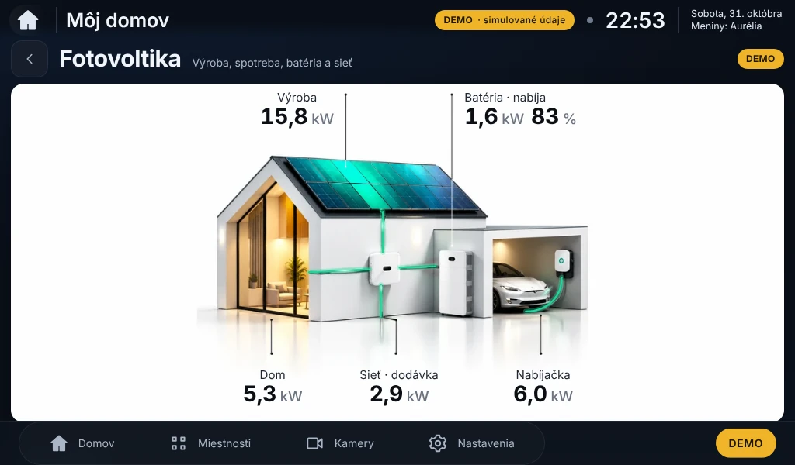
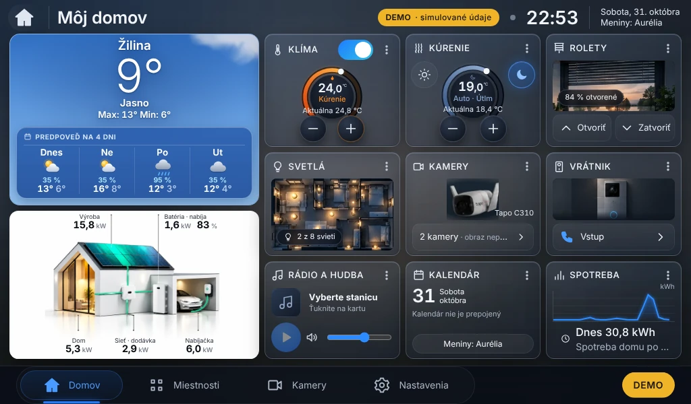

# SolarGroup Home 0.5.3 – biela Tesla a tyrkysovozelené panely

Stav: **pripravené a otestované v projektovej vetve, čaká na potvrdenie inštalácie.**
Na Raspberry Pi sa nič neinštalovalo. SolarGroup PV Dashboard v1.4 sa nemení (skripty ho iba čítajú).

Aktualizácia **0.5.2 → 0.5.3** mení iba grafiku modulu Fotovoltika podľa schváleného návrhu (commit `45dc8de`):
biela Tesla v garáži presne podľa predlohy (pôvodná poloha a nabíjací kábel), panely tyrkysovozelené aj bez výroby,
pri výrobe výrazná žiara (jas 0,6 + výkon/10). Biele pozadie, dom, batéria, menič, wallbox, dynamické hodnoty
a optimalizované toky ostávajú. Ostatné moduly vrátane počasia E4 sa nemenia. Python balíky ani databáza sa nemenia.




## 1. Výsledky testov

| Test | Výsledok |
|---|---|
| Backend `ruff check`, `ruff format`, `pytest` | ✅ 86 / 86 |
| Frontend `tsc`, `vitest`, `vite build` | ✅ 61 / 61 |
| `npm audit` | ✅ 0 zraniteľností |
| `shellcheck` (inštalačné skripty) | ✅ |
| E2E (Playwright, Chromium) | ✅ **126 / 126** – 1024 × 600, 1280 × 800, 1366 × 768, 1920 × 1080, 2560 × 1440, mobil; všetky moduly bez posúvania, 5 hodnôt fotovoltiky v karte, toky iba cez `transform`, počasie E4 (karta → stránka → deň → radar → uvoľnenie mapy), rádio bez autoštartu, klávesnica |
| Dlhý beh 5 min | ✅ pamäť stránky 9,5 → 9,5 MB |
| Prekresľovanie (10 s nečinnosti, 1024 × 600) | ✅ 0 – Môj domov, Fotovoltika, Počasie; hlavné vlákno 0,2–0,9 % |
| Pamäť backendu | ✅ ustálená na 113 MB (4× prechod všetkými obrazovkami) |
| Simulácia na „Pi“ (náhradné systemctl/sudo) | ✅ 0.5.2 → preflight → úplná záloha → dry-run → **0.5.3** (bez pip) → prihlásenie, nastavenia rádia a všetky API zachované → **návrat na 0.5.2** s rovnakými nastaveniami; PV Dashboard v1.4 nezmenený |

Neoverené (vyžaduje skutočné Pi): zaťaženie CPU/GPU na Pi 4 a vzhľad na 7" displeji – zmerať v krokoch 3 a 8.

## 2. Inštalačný balík

- [solargroup-home-pi-0.5.3.tar.gz](https://github.com/1978jaro-pixel/SolarGroup-Home/raw/claude/epic-einstein-cmyx90/kontrola/solargroup-home-pi-0.5.3.tar.gz) (17 MB)
- [solargroup-home-pi-0.5.3.tar.gz.sha256](https://github.com/1978jaro-pixel/SolarGroup-Home/raw/claude/epic-einstein-cmyx90/kontrola/solargroup-home-pi-0.5.3.tar.gz.sha256)
- SHA-256: `24e172538a5248f1fae7a6ce15556b3744455fa4891a507cbda5d3184cc32f40`

Balík obsahuje: aplikáciu, `install-pi-update.sh` (aktualizácia so zálohou a automatickým návratom pri chybe),
`sgh-preflight.sh` (kontrola bez zmien), `sgh-full-backup.sh` (úplná záloha), `sgh-rollback.sh` (návrat).

## 3. Postup inštalácie krok za krokom (až po potvrdení)

**1. Stiahnutie a prenos (na PC)** – stiahnuť oba súbory z bodu 2 a skopírovať na Pi:
```bash
scp solargroup-home-pi-0.5.3.tar.gz solargroup-home-pi-0.5.3.tar.gz.sha256 solargroup@192.168.1.192:~/
```

**2. Kontrola a rozbalenie (na Pi, `ssh solargroup@192.168.1.192`):**
```bash
cd ~
sha256sum -c solargroup-home-pi-0.5.3.tar.gz.sha256       # musí vypísať: OK
mkdir -p ~/sgh-053 && tar -xzf solargroup-home-pi-0.5.3.tar.gz -C ~/sgh-053
cd ~/sgh-053/solargroup-home-pi-0.5.3 && cat VERSION        # 0.5.3
```

**3. Meranie pred aktualizáciou a predbežná kontrola (nič nemení):**
```bash
top -b -n 3 -d 5 | grep -E "Cpu|chromium|python" | tail -12 > ~/meranie-pred-0.5.3.txt
./sgh-preflight.sh
```
Očakávané: „nainštalovaná verzia: 0.5.2, nová: 0.5.3“, „Python balíky sa nemenia“, „kontrola prešla“.
Pri „NEPOKRAČUJTE“ zastaviť a poslať výstup.

**4. Úplná záloha verzie 0.5.2** (služba stojí ~1 minútu):
```bash
./sgh-full-backup.sh
B=$(ls -d ~/solargroup-home-backups/UPLNA-* | tail -1); (cd "$B" && sha256sum -c --quiet SHA256SUMS && echo ZALOHA-OK)
```

**5. Skúška bez zmien:**
```bash
./install-pi-update.sh --dry-run
```
Plán musí obsahovať „NEMENÍ SA: backend/data, backend/.env, .venv, služba systemd, …solar-dashboard-v1.4“ a žiadny `pip`.

**6. Aktualizácia** (potvrdiť „a“; druhá záloha do `~/solargroup-home-backups/<čas>-v0.5.2`; pri chybe automatický návrat):
```bash
./install-pi-update.sh
```

**7. Načítanie novej verzie na displeji:**
```bash
~/solargroup-home-kiosk/sgh-kiosk.sh --restart
curl -s http://127.0.0.1:8080/api/health; echo
```

**8. Kontrola:**
```bash
sleep 60; top -b -n 3 -d 5 | grep -E "Cpu|chromium|python" | tail -12 > ~/meranie-po-0.5.3.txt; free -h
```
Na displeji: biela Tesla v garáži, tyrkysovozelené panely (pri výrobe svietia), 5 hodnôt, zelené toky pri výkone;
detail Fotovoltika celý viditeľný; počasie, rádio, kalendár a ostatné moduly ako predtým; PV Dashboard v1.4 funguje.

## 4. Návrat na 0.5.2

```bash
BK=$(ls -d ~/solargroup-home-backups/2*-v0.5.2 | tail -1); echo "$BK"
"$BK/sgh-rollback.sh" "$BK"
~/solargroup-home-kiosk/sgh-kiosk.sh --restart
curl -s http://127.0.0.1:8080/api/health; echo
```
Posledná možnosť (vrátane `.venv`, `.env`, systemd a kiosku): `~/solargroup-home-backups/UPLNA-<dátum>-v0.5.2/OBNOVA.txt`.
Nastavenia, databáza, `backend/.env` a účty ostávajú pri aktualizácii aj návrate (overené v simulácii).
