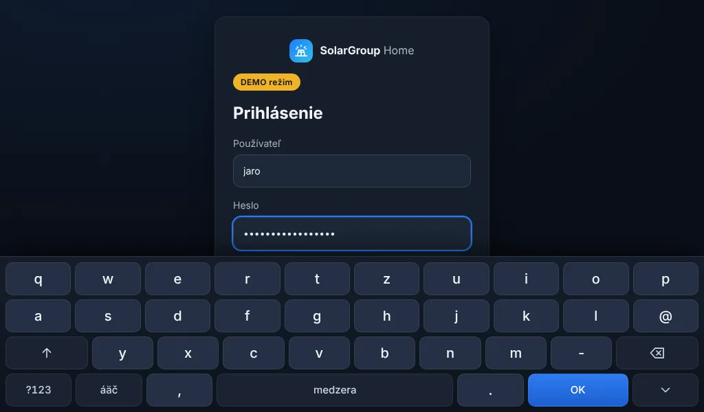

# Raspberry Pi 4 – kiosk na 7" displeji (verzia 0.3.0)

Cieľová zostava: Raspberry Pi 4 (1 GB RAM), Debian 13, labwc (Wayland), Waveshare 7" 1024 × 600
na výstupe `HDMI-A-2`, Chromium. Úpravy sú kompatibilné s Pi 5 a väčšími displejmi.

> **Stav overenia:** všetko v tomto dokumente bolo vyvinuté a otestované **bez fyzického Raspberry Pi**
> (Chromium v emulovanom rozlíšení, simulované `systemctl`). Testy na skutočnom hardvéri sú v tabuľke
> na konci označené ako **NEOVERENÉ** a treba ich vykonať po nasadení.

## 1. Hlavná obrazovka 1024 × 600 bez posúvania

### Rozloženie (v0.3.0 – schválené)

Od verzie 0.3.0 má 7" displej **rovnaké rozloženie ako schválený návrh „Môj domov“** – všetkých
11 modulov (vľavo Počasie a Fotovoltika, vpravo 3 × 3) bez posúvania. Podrobnosti a snímky:
[V0_3_0_AUDIT_A_PLAN.md](V0_3_0_AUDIT_A_PLAN.md), kapitola 2.

- Ťuknutie na kartu otvorí detail (Klíma a Kúrenie ako okno, ostatné ako stránka modulu);
  ťuknutie do stredu regulátora otvorí jeho detail, tlačidlá − / + menia teplotu priamo.
- Rozmery sa počítajú z rozmerov bunky (CSS container queries), nie zo `zoom` – rovnaká kompozícia
  na 1024 × 600 aj Full HD; na mobile ostáva posuvný zoznam.
- Implementácia: `frontend/src/pages/HomeBoard.tsx`, `hooks/useLayoutMode.ts`, štýly v
  `styles/global.css` (blok „board“). Platí pre šírku ≥ 900 px, výšku ≥ 500 px, na šírku.

## 2. Integrovaná dotyková klávesnica

squeekboard/wvkbd nie sú v kiosku spoľahlivé, preto má aplikácia vlastnú klávesnicu
(`frontend/src/components/VirtualKeyboard.tsx`).

- Zobrazí sa **iba v režime kiosku** (adresa `?kiosk=1`, ktorú používa spúšťač, alebo Nastavenia →
  Tento displej) po dotyku textového poľa – prihlásenie, nastavenia, akékoľvek textové pole.
- Vrstvy: písmená (QWERTZ), slovenské znaky (áäčďé…), čísla, symboly; Shift (dvojklik = Caps Lock),
  Zmazať (podržaním opakovane), medzera, **OK** (odošle formulár), skrytie klávesnice.
- Heslo sa nezobrazuje – klávesnica nemá náhľad stlačeného znaku a pole ostáva typu `password`.
- Pole sa posunie nad klávesnicu, okná (modály) sa zdvihnú – klávesnica nezakryje aktívne pole.
- **USB klávesnica** funguje ďalej; pri jej použití sa dotyková klávesnica skryje.
- Na mobile a PC (bez režimu kiosku) sa nezobrazí – používa sa systémová klávesnica, nikdy nie dve.
- Systémová klávesnica sa v kiosku potlačí (`inputmode="none"`).



Poznámka: aplikácia zatiaľ **nemá stránku nastavení Wi-Fi** (Wi-Fi spravuje systém). Klávesnica
funguje vo všetkých textových poliach aplikácie, takže bude fungovať aj vo formulári Wi-Fi, ak pribudne.

## 3. Čierna obrazovka / nestabilita HDMI – analýza

### Čo je známe (od používateľa)

- výstup `HDMI-A-2`, 1024 × 600, labwc; predtým `swayidle` + `wlopm` s časom 30 s
- `wlopm` hlásil `HDMI-A-2 off`, `wlopm --on` nie vždy pomohol
- obnova pomohla iba `sudo systemctl restart lightdm`
- `vcgencmd get_throttled` = `0x0`, voľná RAM ~578 MB, logy bez jasnej príčiny
- `swayidle` je teraz vypnutý

### Hypotézy (ŽIADNA nie je potvrdená)

| # | Hypotéza | Čo by ju podporilo v diagnostike | Čo by ju vyvrátilo |
|---|---|---|---|
| A | Výstup vypol plánovač nečinnosti (swayidle → `wlopm --off`) a prebudenie zlyhalo | `enabled=disabled` alebo `dpms=Off` pri `status=connected`, v procese beží swayidle, výpadok ~30 s po poslednom dotyku | výpadok aj bez swayidle |
| B | Zlyhanie opätovného zapnutia výstupu v labwc/DRM (`wlopm --on` bez účinku) | po `wlopm --on` stále `dpms=Off`/`disabled`; pomôže `wlr-randr --on`/nový režim alebo až reštart lightdm | `wlopm --on` vždy pomôže |
| C | Strata HDMI signálu / HPD (kábel, napájanie displeja, EDID) | `status=disconnected`, v `dmesg` hotplug/EDID chyby od vc4/drm | `status=connected` počas výpadku |
| D | Pád Chromia (napr. nedostatok RAM) | labwc beží, Chromium nie; v `kiosk.log` „Chromium skončil“; OOM v `dmesg` | Chromium beží celý čas |
| E | Pád kompozitora labwc | labwc nebeží, lightdm áno; chyby v journale | labwc beží |
| F | Chromium beží, ale prestal vykresľovať (GPU proces) | DRM aj procesy v poriadku, obraz čierny; pomôže reštart iba Chromia | |

`get_throttled=0x0` znižuje pravdepodobnosť problému s napájaním Pi, ale nevylučuje napájanie
displeja. Skutočná príčina sa určí až z diagnostiky zachytenej **počas** výpadku.

### Diagnostika

| Skript | Účel |
|---|---|
| `sgh-diag.sh [all\|backend\|display] [--reason "…"]` | Uloží úplný stav (RAM, throttled, teplota, DRM status/enabled/dpms, wlopm, wlr-randr, procesy, journal, dmesg, logy kiosku) do `~/.local/state/solargroup-home/diag/`. Iba číta. Na konci vypíše, ktorým hypotézam údaje **zodpovedajú** – nie potvrdenú príčinu. |
| `sgh-watch.sh` | Beží na pozadí (spúšťa ho autostart), každých 10 s zapisuje **iba zmeny** stavu HDMI/labwc/Chromia/backendu do `watch.log` a raz za hodinu súhrn RAM. Pri prechode do zlého stavu automaticky spustí `sgh-diag.sh` – zostane záznam presne z okamihu výpadku. |
| `sgh-display-recover.sh [--lightdm]` | Obnova bez reštartu Pi: najprv uloží diagnostiku, potom postupne `wlopm --on` → `wlr-randr --on` → `wlr-randr` off/on s režimom 1024x600 → reštart Chromia. Po každom kroku overí stav v `/sys/class/drm`. Reštart lightdm iba s `--lightdm` a po napísaní „ANO“. |

Postup pri čiernej obrazovke (z iného zariadenia cez SSH):

```bash
~/solargroup-home-kiosk/sgh-diag.sh --reason "čierna obrazovka"   # najprv zachytiť stav
~/solargroup-home-kiosk/sgh-display-recover.sh                      # potom šetrná obnova
```

Diagnostické súbory pošlite na analýzu. `dmesg` môže vyžadovať `sudo` – úplnejší záznam:
`sudo -E ~/solargroup-home-kiosk/sgh-diag.sh`.

### Uspávanie displeja

- **Predvolene je displej stále zapnutý** (počas testovania). Nič v balíku HDMI nevypína.
- **Šetrič v aplikácii** (Nastavenia → Tento displej → 5/15/30 min): čierna vrstva cez celú obrazovku,
  HDMI zostáva zapnuté, prvý dotyk iba zobudí (nič nestlačí). Toto je odporúčaný a bezpečný spôsob.
- **Skutočné vypnutie HDMI** (`sgh-display-sleep.sh`, experimentálne): `swayidle` + `wlopm`, po
  prebudení dotykom overí stav a pri neúspechu spustí obnovu. Zapína sa iba ručne
  (`SGH_SLEEP_MINUTES` v `kiosk.env` a odkomentovanie riadku v autostarte). Kým diagnostika
  nevysvetlí hypotézu B, **neodporúčame ho**.
- Celé Raspberry Pi sa nikdy automaticky nereštartuje.

### Ostrosť a výkon (etapa E1)

- **Mierka 1:1:** na 1024 × 600 musí byť okno 1024 × 600 CSS px a mierka (device pixel ratio) 1.
  Overenie priamo na displeji: Nastavenia → Tento displej → **Zistiť parametre displeja**
  (rozlíšenie, mierka, GPU, pamäť stránky) a **Zmerať plynulosť (FPS)**. Pri neceločíselnej mierke
  aplikácia upozorní – vtedy nastavte mierku výstupu na 1 (`wlr-randr --output HDMI-A-2 --scale 1`)
  alebo v `~/.config/solargroup-home/kiosk.env` `SGH_CHROMIUM_EXTRA=--force-device-scale-factor=1`.
- **GPU:** ak diagnostika ukáže softvérové vykresľovanie (SwiftShader/llvmpipe), Chromium nepoužíva
  GPU – na Pi 4 má byť „V3D“. Skúšobne `SGH_CHROMIUM_EXTRA=--enable-gpu-rasterization`
  (zmenu vždy porovnať meraním FPS).
- **Bez CSS zoomu a transformácií textu:** veľkosti sa počítajú z rozmerov bunky; text sa nikdy
  nezväčšuje transformáciou. Sklenený vzhľad nepoužíva `backdrop-filter` (rozmazanie je vopred
  pripravené v obrázku pozadia), takže obsah kariet sa nerozmazáva.
- **Obrázky v dvoch veľkostiach:** solárny dom 826 px pre 7" a 1651 px pre Full HD (prehliadač
  si vyberie sám). E2E test kontroluje, že sa žiadny obrázok nezväčšuje nad svoje rozlíšenie.
  Výnimka: dočasná fotografia počasia (na 7" 1,08×, na Full HD rozmazaná – čaká na podklad G4).
- **Animácie:** toky energie sú SVG čiary s pohybujúcimi sa impulzmi (iba pri skutočnom výkone).
  Prepínač **Bez animácií** (Nastavenia → Tento displej) vypne všetky animácie a prechody;
  rovnako sa správa systémové nastavenie „obmedziť pohyb“.

## 4. Stabilný kiosk (`sgh-kiosk.sh`)

- Spúšťa sa z `~/.config/labwc/autostart` až po pripravení Wayland relácie (čaká na socket
  `$XDG_RUNTIME_DIR/$WAYLAND_DISPLAY`) a backendu (`/api/health`, max. 3 min).
- **Iba jedna inštancia** (`flock`); vlastný profil Chromia `~/.local/share/solargroup-home/chromium-kiosk`,
  takže sa nemieša s iným Chromiom.
- Pri páde Chromium **automaticky znovu spustí** (pauza 2, 4, 8 … max. 60 s pri opakovaných pádoch);
  po 3 rýchlych pádoch za sebou uloží diagnostiku. Potlačí ponuku „Obnoviť stránky?“.
- Prepínače pre 1 GB RAM: `--renderer-process-limit=2`, cache 32 MB, vypnuté synchronizácia,
  preklady, aktualizácie komponentov, sieťové služby na pozadí; `--disable-pinch`,
  `--overscroll-history-navigation=0` (dotyk nemení mierku ani nenaviguje späť).
- Ovládanie: `sgh-kiosk.sh --status | --restart | --stop`.
- Logy: `~/.local/state/solargroup-home/kiosk.log`, `chromium.log`, `watch.log` (rotácia pri 2 MB).
- Backend ostáva **existujúca** služba `solargroup-home.service` (žiadna nová služba);
  diagnostika backendu: `sgh-diag.sh backend`, GUI: `sgh-diag.sh display`.

## 5. Inštalácia na existujúcu inštaláciu

Balík sa zostaví na PC: `scripts/build-pi-package.sh` → `build/solargroup-home-pi-0.2.0.tar.gz`
(obsahuje hotový frontend, Node.js na Pi netreba).

```bash
# na Pi ako používateľ grafickej relácie (napr. solargroup), NIE ako root
tar -xzf solargroup-home-pi-0.2.0.tar.gz
cd solargroup-home-pi-0.2.0
./install-pi-update.sh --dry-run      # kontroly a plán, nič nemení
./install-pi-update.sh                # po potvrdení: záloha → aktualizácia → overenie
~/solargroup-home-kiosk/sgh-autostart.sh enable   # zapnutie kiosku (ukáže rozdiel, opýta sa)
```

Inštalátor:

1. zistí inštaláciu zo služby `solargroup-home.service` (adresár, používateľ, Python, port);
2. skontroluje systém, RAM (varovanie pod 300 MB voľnej), miesto na disku, Python 3.11+, curl,
   Chromium, wlopm/wlr-randr (nič neinštaluje, iba vypíše `apt` príkaz);
3. zastaví službu a **zálohuje** do `~/solargroup-home-backups/<čas>-v<verzia>/`: celú aplikáciu
   vrátane `backend/data` (databáza, účty, nastavenia) a `.env`, popis služby, autostart labwc,
   nastavenia a skripty kiosku, a vloží do zálohy aj `sgh-rollback.sh`;
4. nahradí iba `backend/app`, `frontend/dist`, `deploy`, `docs`, `scripts` – **nemení** údaje, `.env`,
   `.venv` ani službu systemd; `pip install` iba ak sa zmenili požiadavky;
5. spustí službu, overí `/api/health`; ak neodpovedá, **automaticky vráti** predchádzajúcu verziu;
6. nainštaluje skripty kiosku do `~/solargroup-home-kiosk/` a `~/.config/solargroup-home/kiosk.env`;
7. pred aj po porovná odtlačok `/home/solargroup/solar-dashboard-v1.4` (adresár iba číta).

Autostart mení iba `sgh-autostart.sh` a vždy po potvrdení a so zálohou: zakomentuje aktívne riadky
s `chromium`/`swayidle`/`squeekboard`/`wvkbd` (značkou `#[SGH-vypnuté]`) a pridá blok SolarGroup Home.
Riadky pôvodného dashboardu v1.4 nemení. `sgh-autostart.sh disable` vráti súbor do pôvodného stavu.
Záloha `/home/solargroup/autostart-povodny-v14.backup` sa nepoužíva ani nemení.

## 6. Návrat (rollback)

```bash
~/solargroup-home-backups/<záloha>/sgh-rollback.sh            # vráti kód, údaje, autostart
~/solargroup-home-backups/<záloha>/sgh-rollback.sh --keep-data  # ponechá súčasné údaje
```

Súčasný stav sa pred návratom odloží vedľa (`<aplikácia>.pred-rollback-<čas>`), nič sa nemaže.
Po návrate sa reštartuje grafická relácia pri ďalšom prihlásení (autostart).
Rýchle vypnutie iba kiosku bez návratu verzie: `~/solargroup-home-kiosk/sgh-autostart.sh disable`.

Návrat k pôvodnému PV dashboardu v1.4 (ručne, iba ak si to želáte):

```bash
~/solargroup-home-kiosk/sgh-autostart.sh disable
cp ~/.config/labwc/autostart ~/.config/labwc/autostart.pred-v14
cp /home/solargroup/autostart-povodny-v14.backup ~/.config/labwc/autostart
```

## 7. Testy

| Test | Ako | Výsledok |
|---|---|---|
| Rozloženie 1024 × 600 – bez posúvania, 11 modulov, menu viditeľné | Playwright/Chromium, `frontend/e2e/kiosk-check.mjs` | ✅ overené v emulácii |
| Rozloženie 1280 × 800, 1366 × 768 (fit), 1920 × 1080, 2560 × 1440, 390 × 844 (mobil) | to isté | ✅ overené v emulácii |
| Ťuknutie na kartu otvorí detail v rámci obrazovky | to isté (dotykové udalosti) | ✅ overené v emulácii |
| Dotykové ciele ≥ 40 px | to isté | ✅ overené v emulácii |
| Klávesnica: písanie, Shift, mazanie, diakritika, OK odošle, heslo skryté | Vitest + Playwright | ✅ overené v emulácii |
| Prihlásenie iba dotykovou klávesnicou na 1024 × 600 | Playwright | ✅ overené v emulácii |
| USB klávesnica funguje, dotyková sa skryje | Playwright (skutočné udalosti klávesnice) | ✅ overené v emulácii |
| Mobil – žiadna druhá klávesnica | Playwright | ✅ overené v emulácii |
| Krátky beh (3 min) – pamäť JS nerastie (9,5 → 9,5 MB) | Playwright (`SOAK_MIN=3`) | ✅ overené v emulácii (nie dlhodobý test) |
| Spúšťač kiosku – jedna inštancia, reštart po páde, postupná pauza | náhradný „chromium“ skript | ✅ simulácia |
| Inštalátor: dry-run, aktualizácia 0.1.0 → 0.2.0, zachovanie účtu a údajov | simulované `systemctl`/`sudo` | ✅ simulácia |
| Inštalátor: chybná verzia → automatický návrat | to isté | ✅ simulácia |
| Rollback 0.2.0 → 0.1.0 vrátane údajov a autostartu, v1.4 nezmenený | to isté | ✅ simulácia |
| Autostart enable/disable (vrátenie bajt po bajte, v1.4 riadky nedotknuté) | testovací súbor | ✅ simulácia |
| Skripty `bash -n` + `shellcheck` | — | ✅ |
| **Reštart Raspberry Pi → kiosk sa spustí sám** | na Pi | ⚠️ **NEOVERENÉ** |
| **Dlhodobý beh (24 h+) na Pi 4 / 1 GB, spotreba RAM Chromia** | na Pi, `watch.log` | ⚠️ **NEOVERENÉ** |
| **Dotyk na skutočnom displeji Waveshare 7"** (presnosť, gestá) | na Pi | ⚠️ **NEOVERENÉ** |
| **Čierna obrazovka / HDMI – príčina** | na Pi, `sgh-diag.sh` počas výpadku | ⚠️ **NEOVERENÉ – príčina nie je známa** |
| **`sgh-display-recover.sh` a `sgh-display-sleep.sh` na labwc** | na Pi | ⚠️ **NEOVERENÉ** |
| **Inštalátor a rollback na skutočnom Debiane 13 so systemd** | na Pi (`--dry-run` najprv) | ⚠️ **NEOVERENÉ** |
| Výkon animácií a regulátorov na Pi 4 | na Pi, Nastavenia → Zmerať plynulosť | ⚠️ **NEOVERENÉ** |
| Ostrosť (mierka 1, GPU V3D) na displeji Waveshare | na Pi, Nastavenia → Zistiť parametre | ⚠️ **NEOVERENÉ** |
| Kontrast kariet na displeji Waveshare (deň/noc) | na Pi, vizuálne | ⚠️ **NEOVERENÉ** |

### Odporúčaný postup testu na Pi

1. `./install-pi-update.sh --dry-run`, potom `./install-pi-update.sh`.
2. V prehliadači na PC otvoriť `http://<ip-pi>:8080` – overiť prihlásenie a údaje.
3. `~/solargroup-home-kiosk/sgh-autostart.sh enable`, reštart Pi (`sudo reboot` ručne).
4. Overiť: kiosk sa spustí sám, 11 modulov bez posúvania, klávesnica pri prihlásení, USB klávesnica.
5. Nechať bežať ≥ 24 h; potom `grep súhrn ~/.local/state/solargroup-home/watch.log`.
6. Pri čiernej obrazovke: `sgh-diag.sh`, potom `sgh-display-recover.sh`; diagnostiku uschovať.
