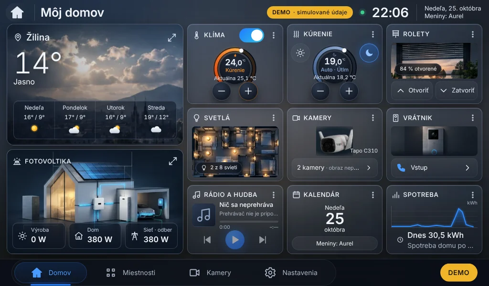

# SolarGroup Home v0.3.0 – audit, návrh a plán

Stav: **na schválenie**. Súčasťou je náhľad hlavnej obrazovky (snímky v
[`docs/navrh-v0.3.0/`](navrh-v0.3.0/)). Ďalšie etapy sa začnú až po schválení náhľadu.
Nič sa nenasadzuje na Raspberry Pi bez výslovného súhlasu.

## 1. Audit – čo projekt má a čo chýba

### 1.1 Dostupné podklady

| Podklad | Stav | Poznámka |
|---|---|---|
| Referencia „Môj domov“ (priložená vo v0.3.0 zadaní) | ✅ | záväzná; rozlíšenie ~1135 × 690 px (iba ako predloha, nie ako zdroj grafiky) |
| `docs/design/schvaleny-navrh-moj-domov.webp` (staršia predloha) | ✅ | mala iné rozloženie pravej časti; **nahrádza ju nová referencia** |
| Obrázok solárneho domu (biely, deň, Taycan) | ✅ | 1651 × 953 px, **obsahuje zapečené hodnoty a texty** → nedá sa použiť priamo |
| Pôdorys bytu (Svetlá) | ✅ | 1125 × 729 px, obsahuje zapečené čísla miestností a ikony → slúži ako predloha |
| Vzor stránky počasia (Magnific) | ✅ | inšpirácia rozloženia; obrázok má vodoznak, nepoužije sa |
| Grafika v aplikácii (`frontend/src/assets/design/`) | ⚠️ | výrezy zo starého návrhu, 300–1136 px – na 7" stačia, na Full HD sú rozmazané |
| Zdrojový kód SolarGroup PV Dashboard v1.4 | ❌ | je iba na Raspberry Pi (`/home/solargroup/solar-dashboard-v1.4`), k nemu nemám prístup. Potrebujem jeho **kópiu** (napr. archív) – originál sa nebude meniť |
| Nástroj na generovanie fotorealistických obrázkov | ❌ | nemám ho → v kapitole 3 je presná špecifikácia podkladov |

### 1.2 Funkcie

| Oblasť | Existuje (v0.2.0) | Chýba pre v0.3.0 |
|---|---|---|
| Hlavná obrazovka | všetky moduly, DEMO/LIVE stavy; 7" mal vlastné rozloženie 4 × 2 | **presné rozloženie podľa referencie** (náhľad hotový), výrazné sklo, kontrast na Pi |
| Klíma, kúrenie | kompletné (regulátor, režimy, týždenné programy, Sinclair schopnosti), DEMO | LIVE adaptéry (brána EMS sa ešte overuje) |
| Fotovoltika | karta + jednoduchá stránka, DEMO dáta, LIVE adaptér na SolarGroup Dashboard API (ak je URL) | celý energetický modul: prehľad, solár/stringy, batéria, wallbox obrazovka, grafy s obdobím, nastavenia FVE (Modbus TCP/RS485), test komunikácie, ukladanie histórie |
| Počasie | Open-Meteo (aktuálne + 7 dní), karta + stránka | 10 dní, hodinová predpoveď, nárazy vetra, pravdepodobnosť zrážok, mapa Európy, výber mesta, radar/oblačnosť, offline vyrovnávacia pamäť |
| Svetlá | zoznam + DEMO | pôdorys s bodmi, priradenie okruhov k bodom v nastaveniach |
| Kamery | DEMO zoznam | reálna Tapo C310 (RTSP/ONVIF → WebRTC/HLS cez lokálnu bránu), bezpečné heslá |
| Rolety, vrátnik, hudba | DEMO / nepripojené | integrácie podľa konkrétnych zariadení (neznáme) |
| Nastavenia | účet, kiosk (klávesnica, šetrič), systém | servisný režim so sekciami (Wi-Fi, displej, FVE, batéria, wallbox, …, používatelia, zálohy, diagnostika) |
| Wi-Fi | ❌ | vyhľadanie, pripojenie s klávesnicou, návrat pri zlyhaní |
| Bezpečnosť | scrypt, HttpOnly cookie, CSRF, limit pokusov, systemd obmedzenia | roly zákazník/servis, úložisko tajomstiev, podpisované aktualizácie, licencie |
| Nasadenie | inštalátor s dry-run, záloha, rollback, diagnostika | migrácie DB pre nové tabuľky (história energie, mapovanie svetiel, nastavenia integrácií) |

## 2. Hlavná obrazovka – náhľad na schválenie

Snímky: [1024 × 600](navrh-v0.3.0/domov-1024x600.webp) · [1280 × 800](navrh-v0.3.0/domov-1280x800.webp) ·
[1920 × 1080](navrh-v0.3.0/domov-1920x1080.webp) · [2560 × 1440](navrh-v0.3.0/domov-2560x1440.webp)

- **Pevné rozloženie podľa referencie** pre každý displej na šírku (od 900 × 500):
  vľavo Počasie (54 %) a Fotovoltika, vpravo mriežka 3 × 3 – Klíma, Kúrenie, Rolety / Svetlá, Kamery,
  Vrátnik / Rádio a hudba, Kalendár, Spotreba. Klíma a kúrenie vedľa seba. Spodná navigácia nezmenená.
- Nahrádza dve doterajšie rozloženia (7" 4 × 2 a nástenné) – všade rovnaká kompozícia, aj na 7".
- Veľkosti v kartách sa počítajú z rozmerov bunky (CSS container queries), nie zo zoomu ani
  `transform: scale` → text a ikony ostávajú ostré. Overené: bez posúvania na 1024 × 600,
  1280 × 800, 1366 × 768, 1920 × 1080, 2560 × 1440; mobil ostáva posuvný zoznam.
- **Kontrast a sklo:** karty majú svetlejšiu priesvitnú výplň, svetelný okraj (1 px + horná
  hrana) a tieň; pozadie je vopred rozmazaný obrázok. Bez `backdrop-filter` – na Pi 4 je drahý
  a pri vypnutej GPU akcelerácii sa nevykreslí (pravdepodobná príčina „tmavých kariet“ –
  **neoverené** na Pi; pôvodná výplň bola takmer nepriehľadná a len o málo svetlejšia ako pozadie).
- Regulátory ostávajú pôvodné; −/+ sú pod stredom regulátora ako na referencii. Na 7" je
  Deň/Noc ako dve okrúhle tlačidlá v rohoch karty Kúrenie (na väčších displejoch celý riadok).
- Odchýlky od referencie (zámerné, na posúdenie):
  - Počasie: fotografia sa nemení podľa počasia (zatiaľ iba jedna) – pri daždi/oblačnosti sa tlmí.
  - Fotovoltika: dom je dočasne pôvodný obrázok z aplikácie (biely dom s garážou, batériou,
    wallboxom); referencia má iný dom. Konečný dom podľa kapitoly 3.
  - Kamery: zrušený neaktívny prepínač v hlavičke (nefunkčné tlačidlo).
  - Rádio: obal albumu sa zobrazí až z pripojeného prehrávača; bez neho ikona.
  - Hodnoty bez pripojenia sa zobrazia „–“, nie „0 W“ (0 W by bola nepravdivá hodnota).
- Dočasné obrázky v náhľade: `weather-zilina.webp` (399 × 201 px, výrez z referencie s odstránenými
  textami) a `backdrop.webp` (z neho rozmazané pozadie). **Na Full HD sú viditeľne rozmazané –
  nahradia sa podkladmi podľa kapitoly 3.**

## 3. Potrebné obrázky a grafické podklady

Všetky bez textov, čísel, ikon a log; formát PNG/TIFF (zdroj) → do aplikácie WebP/AVIF vo dvoch
veľkostiach (pre 7" a pre Full HD/4K). Ak nemáte zdroje, každý podklad má nižšie opis použiteľný
pre grafika alebo nástroj na generovanie obrázkov.

| # | Podklad | Rozlíšenie | Opis |
|---|---|---|---|
| G1 | **Solárny dom – večer** (hlavný) | min. 2560 × 1440, ideálne 3840 × 2160 | Architektúra podľa priloženého obrázka: biely moderný dom, sedlová strecha s čiernomodrými panelmi, veľká presklená obývačka s teplým svetlom, menič na stene, batériové úložisko, garáž vpravo, sivé Porsche Taycan, wallbox s káblom. Tmavomodrá večerná obloha, mierny nadhľad zľava, priestor hore a dole pre údaje (cca 20 % výšky). Bez svietiacich tokov energie. |
| G2 | Vrstvy tokov energie k G1 | rovnaké | Buď samostatné PNG masky trás (panely → menič, menič → dom, menič ↔ batéria, menič ↔ sieť, menič → wallbox → auto), alebo zoznam súradníc trás – animácie sa vykreslia v SVG nad obrázkom podľa skutočných smerov a výkonov. |
| G3 | Taycan pri wallboxe (obrazovka Auto/Wallbox) | 2560 × 1440 | Sivé Porsche Taycan v garáži, bočný/trojštvrťový pohľad, wallbox s káblom, tmavé prostredie, teplé svetlo; priestor vľavo pre údaje. Inšpirácia: pôvodný PV Dashboard. |
| G4 | Počasie – Žilina | 2560 × 1440, 6 variantov | Rovnaký záber mesta s horami a kostolom: jasno, polojasno, zamračené, dážď, sneh, noc. Horná tretina obloha (pre text), dolná štvrtina pokojná (pre predpoveď). |
| G5 | Pozadie aplikácie | 1920 × 1080 | Tmavá rozmazaná krajina (z G4), farebne zladená s kartami. |
| G6 | Pôdorys bytu – čistý | min. 2400 px šírka | Ako priložený pôdorys, ale **bez čísel, názvov a ikon žiaroviek** a so zhasnutými svietidlami (body svetiel vykreslí aplikácia). Ideálne aj verzia pre deň. |
| G7 | Kamera Tapo C310, vrátnik, okno s roletou | 1200 px šírka | Ako na referencii, s priehľadným alebo tmavým pozadím. |

Ak dodáte obrázok iba v malom rozlíšení, nebudem ho len zväčšovať – zostane dočasný a označený.

## 4. Návrh obrazoviek

- **Fotovoltika** (`/fotovoltika`), záložky hore: Prehľad · Solár · Batéria · Auto · Grafy · Nastavenia.
  - Prehľad: veľký dom G1 + toky G2, dlaždice Solár, Dom, Sieť (odber/dodávka), Batéria (výkon, SOC),
    Wallbox; dnešná výroba, spotreba, sebestačnosť.
  - Solár: celkový výkon, stringy (PV1…PVn: U, I, P) podľa toho, čo menič poskytuje, denná/celková
    výroba, stav a chyby meniča.
  - Batéria: SOC (veľký prstenec), nabíjanie/vybíjanie, stav (teplota, SOH ak je), graf SOC a výkonu.
  - Auto: obrazovka na celú plochu s G3 – výkon nabíjania, energia v relácii, stav wallboxu,
    prúd/napätie/fázy (ak sú), podiel FV (iba ak sa dá spoľahlivo spočítať zo synchronných meraní),
    graf relácie; SOC auta iba z podporovanej integrácie.
  - Grafy: výroba, spotreba, sieť, batéria; deň/týždeň/mesiac/rok/vlastné obdobie.
  - Nastavenia: výrobca/model meniča, IP, Modbus TCP alebo RS485 (port, rýchlosť, Unit ID),
    **Test komunikácie**, batéria, wallbox.
  - OFFLINE: pri výpadku komunikácie sa hodnoty zosivia, zobrazí sa OFFLINE a čas posledných údajov.
- **Počasie** (`/pocasie`): veľká aktuálna karta, 10 dní, hodinový pás (teplota, zrážky + pravdepodobnosť,
  vietor + nárazy), mapa Európy (výber mesta ťuknutím alebo vyhľadaním), vrstvy radar/oblačnosť.
- **Svetlá** (`/svetla`): pôdorys G6 na celú plochu, svietiaci/sivý bod na okruh, ťuknutie prepne
  (iba skutočne pripojené zariadenie, inak bod neaktívny s vysvetlením), Zapnúť/Vypnúť všetko.
- **Nastavenia / servisný režim**: zoznam sekcií zo zadania; každá integrácia má stav
  (Nepodporované / Nenastavené / OK / Chyba) a tlačidlo Test komunikácie.

## 5. Návrh implementácie

- **Dáta energie:** nová tabuľka histórie (`energy_samples`, 1 min → agregácia 15 min/deň), adaptér
  meniča cez Modbus TCP/RS485 (`pymodbus`) s mapou registrov podľa výrobcu. Najprv preskúmam v1.4
  (registre, výpočty, overené postupy) – **iba z kópie**, originál ostane nedotknutý.
  Potrebujem: výrobcu a model meniča, batérie a wallboxu (na obrázku je pravdepodobne GoodWe – prosím potvrdiť).
- **Počasie:** Open-Meteo (forecast + hourly, 10–16 dní). Pozor: bezplatné API Open-Meteo je
  **iba na nekomerčné použitie** – pri komerčnom nasadení treba platený plán alebo vlastnú inštanciu
  (open-source). Mapa: offline vektorové dlaždice Európy (Protomaps/PMTiles, OpenStreetMap ©,
  bez API kľúča, funguje lokálne). Radar/oblačnosť: RainViewer alebo SHMÚ/EUMETSAT – podmienky
  a licencie **overím pred implementáciou**; ak nebudú vhodné, vrstva radar sa nezobrazí.
  Offline: posledná predpoveď v SQLite s časom aktualizácie.
- **Kamera Tapo C310:** lokálna brána **go2rtc** (jeden binárny súbor, ~20 MB RAM) – RTSP z kamery
  (účet kamery v aplikácii Tapo) → WebRTC/MSE do prehliadača; prehliadač nikdy nedostane RTSP URL
  ani heslo. ONVIF na zistenie a PTZ (C310 PTZ nemá). Na Pi 4/1 GB: substream 640 × 360.
- **Wi-Fi:** NetworkManager cez malý pomocný proces s úzkymi právami (polkit pravidlo iba na
  vyhľadanie/pripojenie). Pri zmene: nové spojenie sa skúša 60 s; ak sa nepotvrdí, automatický
  návrat na pôvodné. Pred zmenou upozornenie na stratu vzdialeného prístupu; Ethernet ostáva aktívny.
- **Displej:** zobrazenie rozlíšenia, mierky a device pixel ratio priamo na obrazovke Nastavenia →
  Displej; jas podľa podpory panelu (Waveshare 7" HDMI ho cez softvér väčšinou nepodporuje – overíme).

## 6. Bezpečnosť a ochrana produktu (návrh)

- **Zákaznícky a servisný režim:** dve roly. Servisné sekcie (integrácie, sieť, aktualizácie, licencia)
  len po prihlásení servisným účtom + PIN, s časovým limitom a záznamom v logu. Zákazník ovláda dom
  a vlastné nastavenia.
- **Heslá a tokeny:** používateľské heslá scrypt (už je). Prístupové údaje zariadení (kamera, menič)
  v samostatnom súbore čitateľnom iba službou (`0600`), šifrované kľúčom viazaným na zariadenie.
  Úprimne: kľúč je na tom istom Pi, takže to chráni pred náhodným únikom (záloha, log), nie pred
  útočníkom s plným prístupom ku karte.
- **Systémové oprávnenia:** služba ostáva bez root práv (systemd obmedzenia); privilegované úkony
  (Wi-Fi, reštart kiosku) cez úzky pomocný proces s presne vymenovanými príkazmi.
- **Lokálne API:** predvolene iba 127.0.0.1 (kiosk); prístup z LAN voliteľne s HTTPS (lokálny certifikát),
  CSRF a limity pokusov ostávajú, servisné API len pre servisnú rolu.
- **Aktualizácie:** balík podpísaný Ed25519 (minisign); inštalátor overí podpis pred čímkoľvek,
  inak skončí. Záloha a rollback ako vo v0.2.0.
- **Licencie:** licenčný súbor podpísaný Ed25519 (súkromný kľúč iba u SolarGroup), obsahuje ID
  zariadenia (sériové číslo Pi + machine-id), zákazníka, funkcie a platnosť. Overuje sa **offline**.
  Pri neplatnej/expirovanej licencii sa vypnú iba nadstavbové funkcie a aktualizácie –
  **základné lokálne ovládanie domu funguje vždy, aj bez internetu**.
- **Ochrana pred kopírovaním – hranice:** pri fyzickom prístupe k microSD karte sa dá obsah skopírovať,
  prečítať aj upraviť (napr. vypnúť kontrolu licencie). Väzba na zariadenie, kompilovaný backend
  (napr. Nuitka) a minifikovaný frontend to iba **sťažia**. Výrazne silnejšiu ochranu dáva až hardvér:
  Raspberry Pi 5 / CM4/CM5 so **secure boot** (podpísaný bootloader, kľúč v OTP) a šifrovaný systémový
  oddiel; ani to nie je absolútne. Nesľubujeme nemožnosť kopírovania.

## 7. Plán testovania na Raspberry Pi 4 (1 GB, Waveshare 7", Debian 13)

| Test | Postup | Kritérium |
|---|---|---|
| Rozloženie a ostrosť | kiosk, snímka obrazovky (`grim`), `wlr-randr` | 1024 × 600, mierka 1.0, DPR 1, bez posúvania, ostrý text |
| Kontrast kariet | vizuálne pri dennom svetle a večer | karty zreteľne oddelené od pozadia |
| Plynulosť | `sgh-watch.sh`, Chromium `--enable-gpu-rasterization` vs. bez | ťuknutie → reakcia < 150 ms, žiadne trhanie pri animáciách tokov |
| RAM/CPU | `free -m`, `top` 24 h | voľná RAM > 250 MB, Chromium < 450 MB, CPU v pokoji < 15 % |
| Dlhodobý beh | 72 h kiosk | bez pádu, bez rastu pamäte |
| Reštart | 5× reštart Pi | kiosk sa spustí sám < 90 s |
| Klávesnica, Wi-Fi | pripojenie k inej sieti a návrat | servisný prístup sa nestratí |
| Kamera | go2rtc + C310 substream 1 h | stabilný obraz, CPU < 40 % |
| Offline | odpojenie internetu, odpojenie meniča | OFFLINE + čas posledných údajov, žiadne staré hodnoty ako aktuálne |
| Aktualizácia | dry-run, update 0.2.0 → 0.3.0, rollback | údaje a účty zachované, v1.4 nezmenený |

Testy, ktoré nevykonám bez fyzického Pi, budú v odovzdaní označené ako **NEOVERENÉ**.

## 8. Etapy (každá samostatne nasaditeľná s dry-run, zálohou a rollbackom)

| Etapa | Obsah | Predpoklad |
|---|---|---|
| E0 | audit, plán, náhľad hlavnej obrazovky | ✅ (tento dokument) |
| E1 | hlavná obrazovka finálne + podklady G1, G4, G5 + test na Pi 4 | schválenie náhľadu, podklady |
| E2 | Fotovoltika: dátový model, história, DEMO všetkých záložiek, grafy | – |
| E3 | Fotovoltika LIVE: adaptér meniča/batérie/wallboxu, nastavenia, test komunikácie | kópia v1.4, modely zariadení |
| E4 | Počasie: 10 dní, hodinová, mapa, výber mesta, offline | rozhodnutie o licencii Open-Meteo/radaru |
| E5 | Svetlá: pôdorys G6, body, priraďovanie | podklad G6, typ svetelných zariadení |
| E6 | Servisný režim: rámec nastavení, používatelia/roly, Wi-Fi, displej, zálohy, diagnostika | – |
| E7 | Kamera Tapo C310 (go2rtc) | prístup ku kamere v LAN |
| E8 | Bezpečnosť produktu: podpisované aktualizácie, licencie, úložisko tajomstiev | rozhodnutie o modeli licencií |

Simulácie a DEMO nebudú v žiadnej etape vydávané za hotové integrácie.
