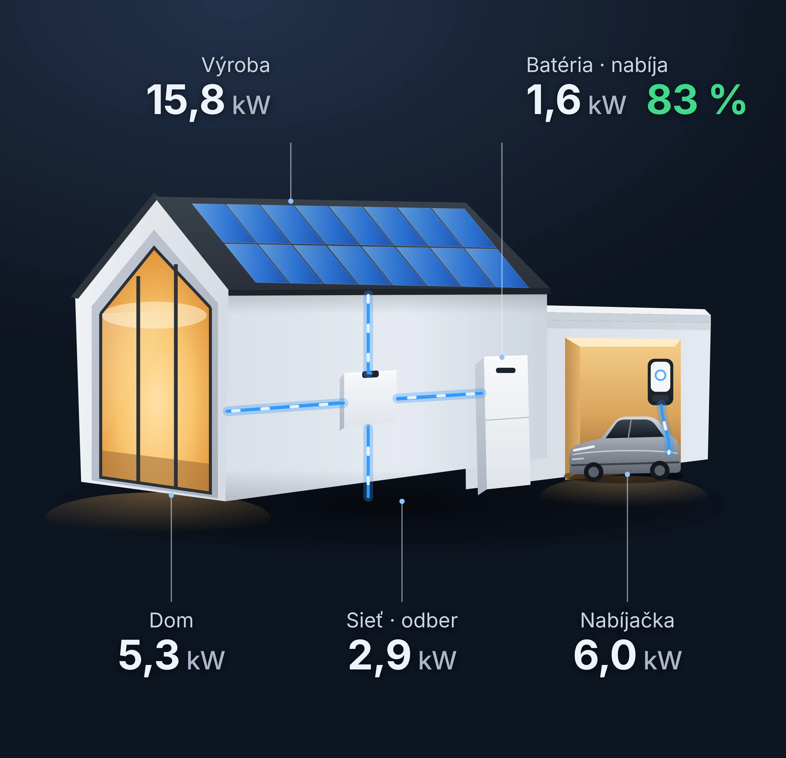
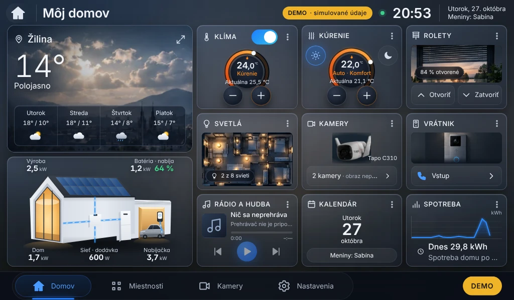
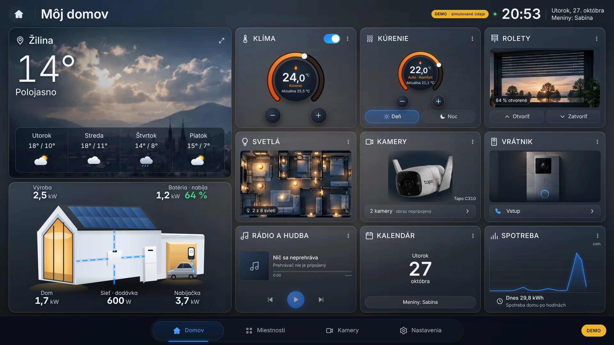

# Návrh E2: nový ostrý podklad solárneho domu (na schválenie)

Stav: **návrh** – do dashboardu sa zatiaľ nezapracoval.

## Ako vznikol

- AI generátor obrázkov v tomto prostredí **nie je k dispozícii**. Dom je preto nakreslený ako
  **vektorová ilustrácia (SVG)** podľa referenčnej fotografie: moderný 3D dom so sedlovou strechou,
  veľkým presklením štítu, panelmi, striedačom, batériou, garážou s nabíjačkou a sivým autom.
- Vektor je **ostrý pri ľubovoľnom rozlíšení** – 7" 1024 × 600, Full HD aj 4K. Nič sa nezväčšuje.
  Pre iné použitie je priložený aj export **3200 px** s priehľadným pozadím.
- Zo schváleného domu ostali: biely dom, teplé svetlo v interiéri, garáž so sivým autom, modré toky
  energie, tmavá večerná paleta dashboardu. Auto je **štylizované** (nízke športové elektrické auto) –
  presná podoba Porsche Taycan vo vektore by vyžadovala ilustrátora alebo 3D model (pozri nižšie).
- Súradnice zodpovedajú referenčnej fotografii (1046 × 1010), takže popisy a toky sedia presne.

## Vrstvy (oddelené, ovládané údajmi)

| Vrstva | Obsah | Ovládanie |
|---|---|---|
| Statický dom | `solarny-dom.svg` – bez textov a hodnôt, priehľadné pozadie | – (prehliadač ho vykreslí raz) |
| Svietiace panely | 16 panelov v rovine strechy | jas podľa výkonu FV; 0 kW = bez žiary |
| Toky energie | FV → striedač, striedač → dom, striedač ↔ batéria, sieť ↔ striedač, wallbox → auto | iba pri skutočnom výkone; smer podľa znamienka, rýchlosť podľa veľkosti |
| Odkazové čiary | ku každému popisu (plná scéna) | – |
| Popisy (React/HTML) | Výroba, Batéria (+ SOC), Dom, Sieť (odber/dodávka), Nabíjačka | hodnoty z API; bez údajov „–“ |

## Dve rozloženia

- **Plná scéna** (stránka Fotovoltika, väčšie displeje): popisy presne podľa referencie – Výroba a Batéria
  hore, Dom, Sieť a Nabíjačka dole, s odkazovými čiarami.
- **Karta na hlavnej obrazovke**: rovnaké rozloženie bez čiar (na 7" by boli príliš husté),
  **bez nadpisu „Fotovoltika“** – ťuknutie na kartu otvorí detail.

Hodnoty na náhľadoch sú **ukážkové** (nie merania).

## Výkon na Raspberry Pi 4

Statický dom je samostatný obrázok (vykreslí sa raz a ostáva v pamäti GPU ako bitmapa); animuje sa iba
tenká SVG vrstva tokov. Prepínač „Bez animácií“ z E1 platí aj tu. Meranie FPS na Pi zostáva **neoverené**.

## Ak chcete fotorealistický vzhľad

Na fotorealistický render (napr. presné Porsche Taycan, materiály, svetlo) by bolo potrebné jedno z:
- AI generátor obrázkov (napr. Midjourney, DALL·E, Adobe Firefly, Stable Diffusion) – vrátim presné zadanie
  a podklad sa potom vyčistí a rozdelí na vrstvy rovnako ako teraz,
- 3D nástroj (Blender) s modelmi domu a auta – render 3840 px a samostatné masky panelov a vedení,
- grafik/ilustrátor podľa tohto SVG ako predlohy.

Súradnice vrstiev (toky, panely, popisy) sa dajú prispôsobiť novému obrázku.
