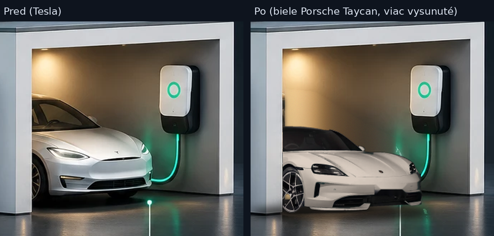

# Návrh: Porsche Taycan namiesto Tesly (na schválenie)

Celý obrázok (1536 × 1024): [dom-porsche-nahlad-1536.png](dom-porsche-nahlad-1536.png)

- Tesla odstránená, zadná stena garáže doplnená plynulým pokračovaním steny.
- Porsche Taycan vyrezané z dodanej fotografie, zrkadlovo otočené (predok k wallboxu ako pôvodné auto),
  veľkosť podľa reálnych rozmerov (výška ~1,38 m oproti otvoru garáže), zadná časť zakrytá stĺpom garáže.
- **Biela farba** karosérie (pôvodný lak prefarbený, sklo, kolesá a svetlá ostali), jemne prispôsobená svetlu garáže; kontaktný tieň pod autom.
- Auto je **viac vysunuté z garáže** (predok na príjazdovej ploche, mierne väčšie – bližšie k pozorovateľovi). Parametre: `taycan_composite.py 0.27 1300 708`.
- Odstránená ŠPZ a vodoznaky fotografie; nabíjací kábel ostáva pred autom.
- Čísla a popisy v obrázku sú zatiaľ pôvodné – odstránia sa v etape C (živé hodnoty v Reacte).

Postup je reprodukovateľný: `tools/design/porsche/taycan_cut.py` a `taycan_composite.py`.

**Licencia:** dodaná fotografia pochádza z webu NetCarShow/CarWale (tlačová fotografia). Na interné testovanie
je to v poriadku, pre **komerčné nasadenie u zákazníkov** treba fotografiu s licenciou na komerčné použitie
(napr. vlastná fotografia, licencovaná fotobanka alebo písomný súhlas).
