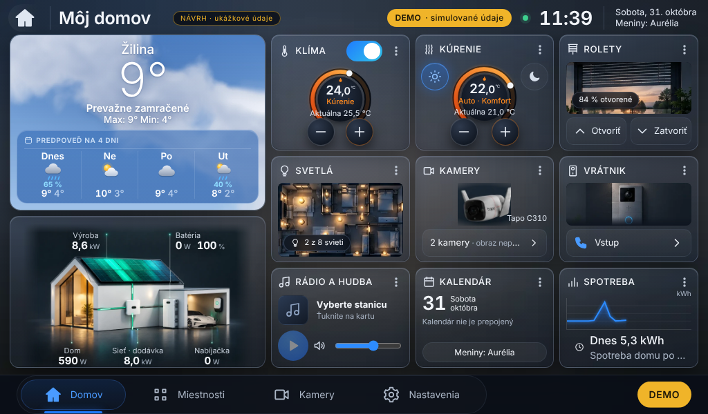
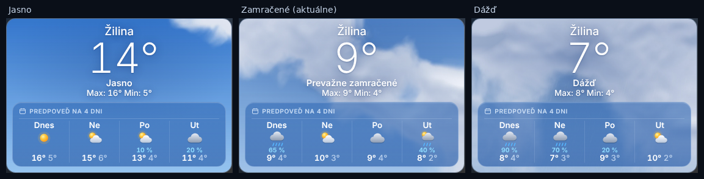

# E4 – Luxusné interaktívne počasie: grafický návrh (na schválenie)

Stav: **iba návrh**. Aplikácia sa nemenila, nič sa neinštalovalo ani nenasadilo.
Všetky hodnoty v náhľadoch sú **ukážkové** (Žilina, koniec októbra); mapa a zrážky na radare sú ilustrácia.

| Obrazovka | Náhľad 1024 × 600 |
|---|---|
| 1. Hlavná stránka počasia |  |
| 2. Detail vybraného dňa (Nedeľa) |  |
| 3. Interaktívny radar |  |

Návrh kombinuje obe referencie: rad oddelených kariet dní so zvýraznenou kartou „Teraz“ (referencia 1)
a hodinovú krivku teploty, stĺpce zrážok, hodinové stĺpce a ovládanie radaru s časovou osou a legendou
(referencia 2). Pozadie je tmavomodré, karty jasne oddelené, ovládacie prvky ≥ 42 px pre prst.

Úvodná obrazovka: z karty Počasie zmizne ikona dvoch šípok, ťuknutie kdekoľvek na kartu otvorí túto stránku.

Zdrojový kód návrhu: `src/navrh.js`, `src/navrh.css`; náhľady vytvorí `src/render.mjs` (proti bežiacej aplikácii v DEMO).

## Karta Počasie na úvodnej obrazovke (návrh na schválenie)

Tri obrazovky vyššie sú **schválené**. Nová karta podľa referencie Apple Weather – svetlá modrá obloha
s oblakmi podľa aktuálneho počasia, veľká biela teplota, Žilina, opis, Max/Min a polopriehľadný panel
s predpoveďou na 4 dni. Veľkosť a poloha karty v mriežke sú nezmenené; ikona dvoch šípok zmizla,
ťuknutie kdekoľvek na kartu otvorí hlavnú stránku počasia E4.

Obloha a oblaky sú **vlastná procedurálne vytvorená grafika** (`tools/design/e4/sky.py`, varianty jasno,
polojasno, zamračené, dážď, sneh, hmla v `karta/`), nie fotografie z Apple ani z internetu. Sú to statické
obrázky – karta nemá nepretržitú animáciu ani rozmazávanie pozadia (šetrné k Raspberry Pi 4).
