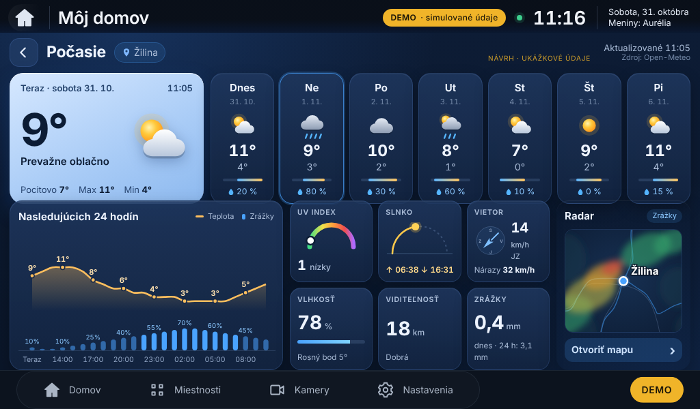
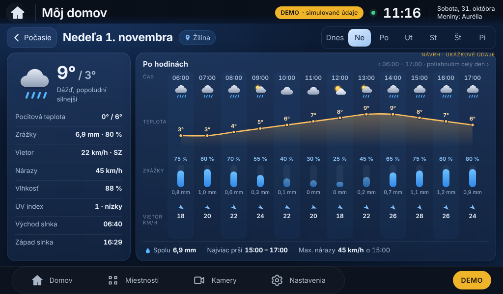
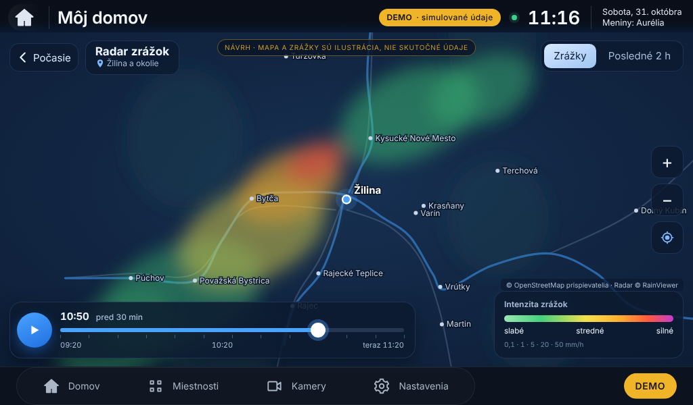

# E4 – Luxusné interaktívne počasie: grafický návrh (na schválenie)

Stav: **iba návrh**. Aplikácia sa nemenila, nič sa neinštalovalo ani nenasadilo.
Všetky hodnoty v náhľadoch sú **ukážkové** (Žilina, koniec októbra); mapa a zrážky na radare sú ilustrácia.

| Obrazovka | Náhľad 1024 × 600 |
|---|---|
| 1. Hlavná stránka počasia |  |
| 2. Detail vybraného dňa (Nedeľa) |  |
| 3. Interaktívny radar |  |

Návrh kombinuje obe referencie: rad oddelených kariet dní so zvýraznenou kartou „Teraz“ (referencia 1)
a hodinovú krivku teploty, stĺpce zrážok, hodinové stĺpce a ovládanie radaru s časovou osou a legendou
(referencia 2). Pozadie je tmavomodré, karty jasne oddelené, ovládacie prvky ≥ 42 px pre prst.

Úvodná obrazovka: z karty Počasie zmizne ikona dvoch šípok, ťuknutie kdekoľvek na kartu otvorí túto stránku.

Zdrojový kód návrhu: `src/navrh.js`, `src/navrh.css`; náhľady vytvorí `src/render.mjs` (proti bežiacej aplikácii v DEMO).
