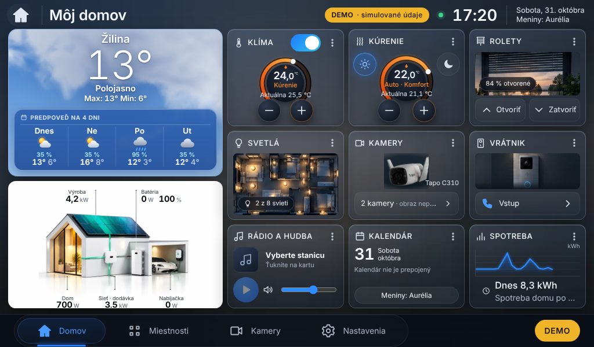
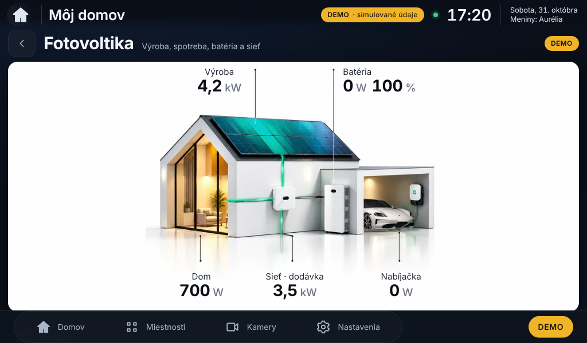
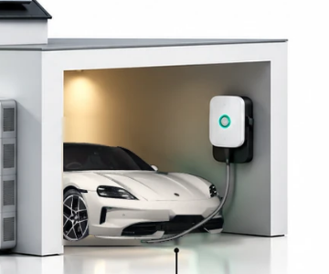

# Fotovoltika na bielom pozadí – návrh na schválenie

Stav: **iba návrh**. Funkčná verzia 0.5.1 sa nemení, na Raspberry Pi sa nič neinštaluje.

| Náhľad | |
|---|---|
| Hlavná obrazovka 1024 × 600 |  |
| Otvorený modul Fotovoltika 1024 × 600 |  |
| Garáž – kontrola ostrosti (2× zväčšené) |  |

- Auto: **biele Porsche Taycan** (schválené) namiesto Tesly – rovnaká poloha predku a kolies, predné koleso
  pri stĺpe garáže ako pri pôvodnom aute, nabíjací kábel navrchu (`tools/design/e5/porsche_white.py`,
  rovnaký výrez Porsche ako v E2).
- Podklad: priložený schválený obrázok domu na čisto bielom pozadí. Zapečené čísla a popisy sú odstránené,
  vodiace čiary s bodkami ostali (spodné sú skrátené, aby nezasahovali do hodnôt).
- Hodnoty sú dynamické (DEMO v náhľade), zobrazené iba raz, tmavým písmom na bielej.
- Žiara panelov a zelené vedenia sú oddelené vrstvy: svietia iba pri skutočnom výkone (v náhľade batéria a nabíjačka 0 W → sivé).
- Animácia svetla tokov je tá istá optimalizovaná (iba `transform`); meranie: 0 prekreslení za 10 s.
- Detail: dom je o ~8 % väčší a celý viditeľný (kompaktnejšia hlavička stránky).
- Ostatné moduly (počasie E4, klíma, …) sa nemenia.

Postup grafiky: `porsche_white.py` (auto) → `house_white.py` (vrstvy) v `tools/design/e5/`. Pripravená zmena aplikácie: `implementacia.patch`
(použije sa až po schválení).
