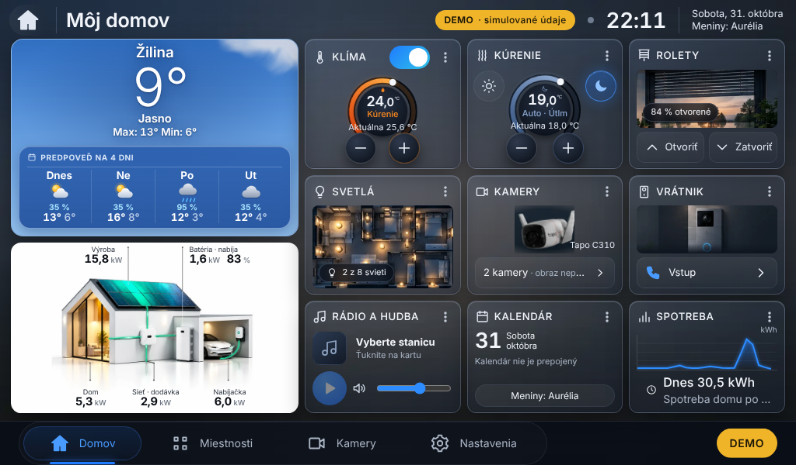
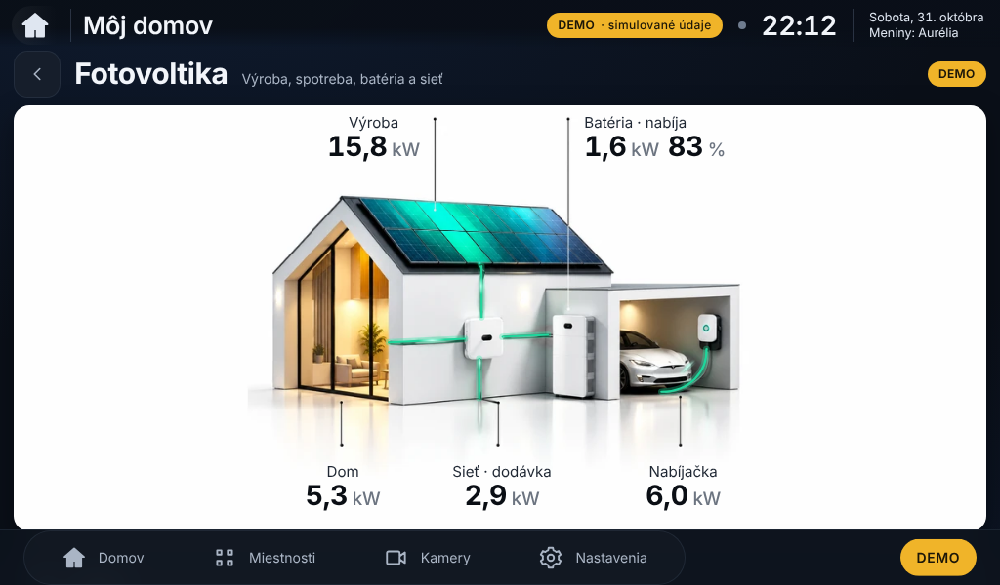
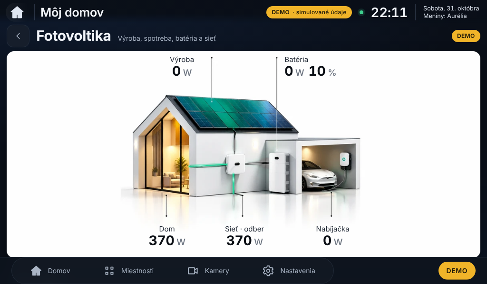

# Fotovoltika: biela Tesla a tyrkysovozelené panely – návrh na schválenie

Stav: **iba návrh**. Funkčná verzia 0.5.2 sa nemení, balík sa nevytvára, na Raspberry Pi sa nič neinštaluje.
Záväzná predloha: obrázok pôvodného domu s bielou Teslou (zhodný so zdrojom použitým pre biele pozadie v E5).

| Náhľad 1024 × 600 | |
|---|---|
| Hlavná obrazovka – deň (ukážkové hodnoty podľa predlohy) |  |
| Fotovoltika – deň |  |
| Hlavná obrazovka – noc (DEMO, výroba 0 W) |  |
| Fotovoltika – noc |  |

- Biela Tesla v garáži presne ako na predlohe (pôvodná poloha, pôvodný nabíjací kábel); Porsche odstránené.
- Panely ostávajú tyrkysovozelené aj bez výroby (tlmenejšie), pri výrobe svietia ako na predlohe:
  jas žiary 0,6 + výkon/10 (predtým 0,35 + výkon/10).
- Čisto biele pozadie, dom, batéria, menič, wallbox bez zmeny; hodnoty dynamické, nič zapečené.
- Tok nabíjania opäť po pôvodnom kábli Tesly; optimalizované animácie (iba `transform`) bez zmeny.
- Denné náhľady: hodnoty z predlohy vložené iba v prehliadači pri tvorbe náhľadu (15,8 kW výroba, 1,6 kW nabíjanie
  batérie 83 %, dom 5,3 kW, dodávka do siete 2,9 kW, nabíjačka 6 kW).

Grafika: `tools/design/e5/house_white.py <predloha> <výstup> --teal`. Pripravená zmena: `implementacia.patch`.

**Schválené** a zapracované vo verzii **0.5.3** – postup: `docs/NASADENIE_0.5.3.md`.
